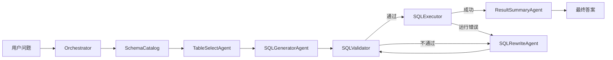

# SQL Agent 设计文档：Agent 划分与编排

> 版本：v0.1（2026-10-22）  
> 范围：基于 `ref/chinook.db` 的单库、单轮自然语言查询  
> 参考实现：`ref/sql-agent.ipynb`（仅作为行为参考，代码需重新组织）

## 1. 目标

实现一条完整、可观测、可控的 SQL Agent 工作流：

**数据库解析 → 表选择 → SQL 生成 → SQL 校验 → SQL 改写 → SQL 执行 → 结果汇总**

核心设计问题不是"用几个 Agent"，而是**哪些步骤应该交给 LLM，哪些必须由确定性代码控制**。本文档给出组件划分、职责边界、数据契约和失败处理策略。

### 非目标（v1）

- 多轮对话、上下文追问
- 多数据库/多方言动态切换
- 写操作（INSERT/UPDATE/DELETE/DDL）
- 完全自主的 Agent 规划（autonomous planning）

## 2. 划分原则

1. **LLM 只做语义判断**：选表、写 SQL、根据错误修复 SQL、把结果转成自然语言。
2. **校验和执行必须是确定性代码**：LLM 不能"批准"自己生成的 SQL，也不能直接持有数据库写权限。
3. **一个 Agent 只做一个决策**：避免一个超长 prompt 同时负责选表、生成、纠错和总结，否则无法定位错误、无法单独重试。
4. **上下文最小化**：选表阶段只看目录摘要；生成/改写阶段只看已选表的详细 schema，降低 token 和幻觉。
5. **编排用 Python 代码，不用 handoff**：流程包含循环、重试上限、安全门禁，代码编排比 Agent 自主交接更可控、更易测试。
6. **失败有界**：所有 LLM 修复循环都有次数上限，超限返回明确错误，不无限重试。

## 3. 组件总览

| 组件 | 类型 | 职责 | 是否 LLM | 建议模型 |
| --- | --- | --- | --- | --- |
| `Orchestrator` | 确定性代码 | 状态机、调用顺序、重试、超时、日志 | 否 | — |
| `SchemaCatalog` | 确定性代码 | 解析 DB、缓存 schema/统计/外键/样例 | 否 | — |
| `TableSelectAgent` | Agent | 从表清单中选择回答所需的最少表集合 | 是 | `qwen-max` |
| `SQLGeneratorAgent` | Agent | 基于问题 + 已选表 schema 生成 SQLite SQL | 是 | `qwen-max` |
| `SQLValidator` | 确定性代码 | 安全门禁、语法/对象校验、只读检查 | 否 | — |
| `SQLRewriteAgent` | Agent | 根据校验或执行错误修复 SQL | 是 | `qwen-max` |
| `SQLExecutor` | 确定性代码 | 只读执行、超时、行数/长度截断 | 否 | — |
| `ResultSummaryAgent` | Agent | 将问题、SQL、结果汇总为自然语言答案 | 是 | `qwen-plus` |



> 图中回边由 `Orchestrator` 控制，最多 3 次修复。

### 3.1 为什么这样拆

| 边界 | 理由 |
| --- | --- |
| 选表 / 生成 SQL 分开 | 选表只需目录级信息，可用工具按需查看单表详情；生成阶段只加载已选表，避免 11 张表全量 schema 干扰。多表问题也能在选表阶段显式确认。 |
| 生成 / 改写分开 | 首次生成是"从问题到 SQL"；改写是"带精确错误诊断的局部修复"。混在一起会导致修复时重写整条 SQL、引入新错误。 |
| 校验不交给 LLM | 语法、表/列是否存在、是否只读、是否多语句，都能确定性判断；LLM 判断安全不可靠。 |
| 执行不交给 Agent | 执行需要固定连接、只读权限、超时和行数上限；不应存在"模型选择是否执行"的空间。 |
| 汇总独立 | 汇总阶段不允许修改 SQL，只负责忠实表达结果；可用更便宜模型，失败时可降级为表格输出。 |
| 解析不交给 Agent | schema、外键、统计信息是客观数据，直接由 SQLAlchemy/SQLite 获取并缓存。 |

## 4. 数据契约

所有 Agent 使用结构化输出（LangChain 的 `with_structured_output` + Pydantic 模型），避免解析自由文本。契约定义在 `src/sql_agent/models.py`。

```python
from enum import Enum
from pydantic import BaseModel, Field


class TableSelection(BaseModel):
    tables: list[str] = Field(description="回答该问题所需的最少表名集合")
    reason: str = Field(description="选择这些表的理由")
    confidence: float = Field(ge=0, le=1)
    needs_clarification: bool = False
    clarification_question: str | None = None


class SQLDraft(BaseModel):
    sql: str
    explanation: str = Field(description="SQL 如何回答用户问题")
    assumptions: list[str] = Field(default_factory=list)


class ErrorCode(str, Enum):
    UNSAFE = "unsafe"                # 非 SELECT / 多语句 / 危险关键字
    SYNTAX = "syntax"                # 语法错误
    UNKNOWN_OBJECT = "unknown_object"  # 表或列不存在
    AMBIGUOUS = "ambiguous"          # 列名歧义
    RUNTIME = "runtime"              # 执行期错误
    TIMEOUT = "timeout"
    EMPTY = "empty"                  # 结果为空（不是错误）


class ValidationResult(BaseModel):
    ok: bool
    code: ErrorCode | None = None
    message: str = ""
    normalized_sql: str = ""


class ExecutionResult(BaseModel):
    columns: list[str]
    rows: list[list[str]]            # 已转字符串，便于日志与汇总
    row_count: int
    truncated: bool = False


class SQLAttempt(BaseModel):
    sql: str
    source: str                      # generator / rewriter
    code: ErrorCode | None = None
    error: str = ""


class FinalAnswer(BaseModel):
    answer: str
    evidence: list[str] = Field(default_factory=list)
    caveats: list[str] = Field(default_factory=list)


class QueryState(BaseModel):
    question: str
    selection: TableSelection | None = None
    schema_context: str = ""
    sql: str | None = None
    attempts: list[SQLAttempt] = Field(default_factory=list)
    validation: ValidationResult | None = None
    execution: ExecutionResult | None = None
    answer: FinalAnswer | None = None
    repair_attempts: int = 0
    stage: str = "init"
```

约定：

- 表名、列名必须与 catalog 完全一致（Chinook 列名为 PascalCase）。
- `rows` 统一字符串化，避免 Decimal/日期序列化差异。
- `repair_attempts` 由 Orchestrator 维护，Agent 无权修改。
- `SQLAttempt` 保留所有失败历史，供改写 Agent 避免重复错误。

## 5. 主流程与状态机

### 5.1 正常路径

1. `SchemaCatalog.load()`：解析 DB，构建目录摘要与详细 schema。
2. `TableSelectAgent`：输入问题 + 目录摘要，输出 `TableSelection`。
3. `Orchestrator` 校验表名合法性，计算所选表之间的外键连接子图。
4. `SQLGeneratorAgent`：输入问题 + 已选表详细 schema + 连接关系 + 样例，输出 `SQLDraft`。
5. `SQLValidator`：安全检查 + `EXPLAIN` 编译校验。
6. `SQLExecutor`：只读执行，限制超时和返回行数。
7. `ResultSummaryAgent`：输入问题、最终 SQL、列、结果行，输出 `FinalAnswer`。

### 5.2 失败与重试

| 场景 | 处理 | 上限 |
| --- | --- | --- |
| 选表返回不存在的表 | 把合法表清单和错误反馈给选表 Agent 重试 | 1 次 |
| 选表结果为多组不连通表 | 提示需要 JOIN，重试选表 | 1 次 |
| 需要澄清（问题歧义/无相关表） | 停止流程，返回澄清问题或"不支持" | — |
| SQL 校验失败 | `SQLRewriteAgent` 修复后重新校验 | 与执行错误共享 3 次 |
| SQL 执行运行错误 | 带错误信息 + 失败 SQL 交给改写 Agent | 共享 3 次 |
| 执行超时 | 带 `TIMEOUT` 提示改写（建议简化/加过滤条件） | 共享 3 次 |
| 查询结果为空 | **不重试**，汇总阶段明确回答"未查询到符合条件的数据" | — |
| 汇总 Agent 失败 | 降级输出：Markdown 表格 + 行数 + 最终 SQL | — |

修复总上限建议为 3 次（`MAX_REPAIR_ATTEMPTS = 3`），校验失败和执行失败共用，避免"校验→执行→再校验"的无限抖动。

### 5.3 编排伪代码

```python
async def answer(question: str) -> FinalAnswer:
    state = QueryState(question=question)
    catalog = get_catalog()  # 进程级单例，按 DB mtime 失效

    selection = await run_table_select(question, catalog, state)
    ensure_valid_tables(selection, catalog)  # 无效则重试 1 次

    state.schema_context = catalog.render_schema(selection.tables)
    draft = await run_sql_generator(question, state.schema_context, state)
    state.sql = draft.sql

    while True:
        state.validation = validate_sql(state.sql, catalog)
        if state.validation.ok:
            try:
                state.execution = execute_readonly(state.sql)
                break
            except ExecutionError as exc:
                state.validation = ValidationResult(
                    ok=False, code=exc.code, message=str(exc)
                )

        if state.repair_attempts >= MAX_REPAIR_ATTEMPTS:
            return failure_answer(state)

        state.repair_attempts += 1
        rewritten = await run_sql_rewriter(state, catalog, state.validation)
        state.sql = rewritten.sql

    return await run_result_summary(state)
```

## 6. 各 Agent 详细设计

### 6.0 编码约定（参考 `ref/agent-demo.py` 的结构）

- Agent 在模块级定义为 `StructuredAgent`（`src/sql_agent/llm.py`），不在每次请求时新建。
- 每个 Agent 由 `ChatPromptTemplate`、`ChatOpenAI` 和 Pydantic 输出模型组成，通过 LCEL 组合成 `prompt | model.bind_tools(...)` 链（工具定义由输出模型的 JSON Schema 生成）。
- 链在首次调用时构建，因此导入模块和运行单元测试不需要 `OPENAI_API_KEY`。
- 流程封装为一个 `Workflow` 类（本项目为 `SQLAgentWorkflow`），用 `await agent.ainvoke(prompt)` 显式调用。
- 分支、循环、重试和最终 JSON 全部由代码控制，不使用 LangChain 的 agent executor / handoff。
- 用户输入放进 `<question>` 标签并声明"仅作为数据"，避免提示注入。
- 最终 `WorkflowOutput` 由代码组装，不由模型拼接。
- 结构化输出用「工具定义 + `tool_choice=auto` + Pydantic 校验」实现：DeepSeek / DashScope 兼容端点不支持 OpenAI 的 `json_schema` 响应格式，而思考模式（thinking mode）模型会直接拒绝强制指定工具的 `tool_choice`（`Thinking mode does not support this tool_choice`），因此不把 `tool_choice` 固定到具体函数。
- 解析顺序：先取 `AIMessage.tool_calls` 的参数，再回退解析正文里的 JSON（兼容代码块）；两者都失败时带错误信息重试一次。`SQL_AGENT_TOOL_CHOICE` 默认 `auto`，仅非思考模型可改成某个输出模型名（如 `SQLDraft`）来强制调用该工具。

### 6.1 TableSelectAgent

**目的**：把自然语言问题映射到最少的表集合，不生成 SQL，不做连接推理。

**输入**

- 用户问题
- 目录摘要：表名、行数、列名列表、外键边
- 可选工具 `get_table_schema(table)`：只允许访问白名单内的表

**输出**：`TableSelection`

**系统提示要点**

```text
你是 SQLite 数据库分析专家。根据用户问题，从给定表清单中选择回答所需的
最少表集合。

规则：
1. 只能从清单中选择表，禁止臆造表名；
2. 多表问题必须返回所有需要的表；
3. 不要生成 SQL，不要猜测连接条件；
4. 如果问题与数据库无关、信息不足或存在歧义，将 needs_clarification
   设为 true，并提出一个具体的澄清问题；
5. 只输出结构化结果。
```

**模型配置**：`qwen-max`，`temperature=0`，低随机性。

**失败处理**

- 返回的表名不在 catalog：Orchestrator 将非法表名和合法清单反馈一次。
- 返回空表集合：视为"无法回答"，走澄清/拒绝路径。
- 不负责计算 JOIN：连接边由 `SchemaCatalog` 根据外键确定。

### 6.2 SQLGeneratorAgent

**目的**：在已选表的范围内，把问题转成一条可执行的 SQLite SELECT。

**输入**

- 用户问题
- 已选表的详细 schema（字段、类型、可空、distinct、min/max、mode、样例值）
- 外键连接关系
- 每条表 3 行样例数据（不要使用参考实现的单行样例）
- 方言说明：SQLite

**输出**：`SQLDraft`

**系统提示要点**

```text
你是 SQLite SQL 专家。只使用给定的表、列和连接关系生成 SQL。
规则：
1. 只生成一条 SELECT 或 WITH ... SELECT 语句；
2. 禁止 INSERT/UPDATE/DELETE/CREATE/DROP/ALTER/PRAGMA/ATTACH；
3. 表名、列名必须与 schema 完全一致；
4. 多表查询使用显式 JOIN，不依赖隐式笛卡尔积；
5. 需要排序的结果给出确定性 ORDER BY；
6. 明细查询默认 LIMIT 200；聚合查询不加 LIMIT；
7. 日期使用 SQLite 语法（如 strftime），不要使用 MySQL 函数；
8. 输出 sql、explanation、assumptions。
```

**工具**：无。生成阶段不应执行或校验 SQL，避免 Agent 反复试探。

**模型配置**：`qwen-max`，`temperature=0`。

**失败处理**：生成结果由 `SQLValidator` 统一校验，不在此 Agent 内重试。

### 6.3 SQLValidator（确定性）

**职责**：唯一有权判断"SQL 是否可进入执行阶段"的组件。

**校验顺序**

1. `normalized_sql = strip_code_fence(sql).strip()`，去掉尾部分号。
2. **安全门禁**
   - 必须单条语句（拒绝 `;` 分隔的多语句）。
   - 必须以 `SELECT` 或 `WITH` 开头（忽略大小写和注释）。
   - 拒绝 `INSERT|UPDATE|DELETE|REPLACE|CREATE|DROP|ALTER|PRAGMA|ATTACH|DETACH|VACUUM|REINDEX|TRIGGER` 等关键字。
   - 可选加固：使用 `sqlite3.Connection.set_authorizer`，仅允许读操作。
3. **语法与对象校验**
   - 在只读连接上执行 `EXPLAIN <sql>`；只编译，不真正执行。
   - 捕获 `no such table` / `no such column` / `ambiguous column name`，映射为 `UNKNOWN_OBJECT` / `AMBIGUOUS`。
4. 返回 `ValidationResult`，保留原始错误信息。

**只读连接**

```python
engine = create_engine(
    "sqlite:///file:ref/chinook.db?mode=ro&uri=true"
)
```

该 URL 已验证可阻止写入。**不要复用参考实现的 `DBParser.check_sql()`**：它通过 `engine.begin()` 真正执行并提交 SQL，不是 dry-run。

**失败分类**：`UNSAFE` / `SYNTAX` / `UNKNOWN_OBJECT` / `AMBIGUOUS`。

### 6.4 SQLRewriteAgent

**目的**：根据精确错误修复 SQL，不重新回答整个问题。

**输入**

- 用户问题
- 已选表 schema 与连接关系
- 当前失败 SQL
- `ValidationResult`（错误码 + 原始错误信息）
- 已尝试过的 SQL 列表（避免重复）
- 当前修复次数

**输出**：`SQLDraft`（复用生成契约），或标记无法修复。

**系统提示要点**

```text
你是 SQLite SQL 修复专家。只修复给定 SQL 中导致错误的部分，
保持用户原始查询意图不变。

规则：
1. 根据错误码定位问题：unsafe / syntax / unknown_object / ambiguous / runtime；
2. 只使用给定 schema 中的表和列；
3. 不要通过改变业务含义来"绕过"错误；
4. 不要重复已失败的 SQL；
5. 如果问题本身无法用当前数据库回答，明确说明 cannot_fix 及原因。
```

**模型配置**：`qwen-max`，`temperature=0.2`。

**失败处理**：修复后必须重新经过 `SQLValidator`；共享 3 次修复预算。

### 6.5 SQLExecutor（确定性）

**职责**：以只读方式执行已通过校验的 SQL。

**约束**

- 只读连接（`mode=ro`），与校验使用同一配置。
- 单条语句。
- 超时：使用 `sqlite3.set_progress_handler` 或线程级超时，建议 5 秒。
- 行数上限：`fetchmany(MAX_ROWS + 1)`，超过 `MAX_ROWS=200` 标记 `truncated=True`。
- 单元格长度上限（如 2000 字符），避免超大文本进入汇总 prompt。
- 返回 `ExecutionResult`：列名、字符串化行、原始行数、是否截断。
- 将异常映射为 `RUNTIME` / `TIMEOUT`，不吞掉错误信息。

**明确不负责**：修复 SQL、生成答案、写库。

### 6.6 ResultSummaryAgent

**目的**：把结构化结果转成忠实、可读的中文答案。

**输入**

- 用户问题
- 最终 SQL
- 列名
- 结果行（最多 50 行进入 prompt；超过则提供前 50 行 + 总行数）
- `row_count`、`truncated`

**输出**：`FinalAnswer`

**系统提示要点**

```text
你是数据分析助手。只依据给定的 SQL 查询结果回答用户问题。
规则：
1. 数字必须与结果一致，不得编造或外推；
2. 结果是多行时，给出整体结论并列举关键数据；
3. 结果为空时，明确回答"未查询到符合条件的数据"，不要猜测原因；
4. 结果被截断时，在 caveats 中说明只展示了部分数据；
5. 不要修改 SQL，不要声称执行了未提供的查询；
6. evidence 中列出支撑结论的具体数值。
```

**模型配置**：`qwen-plus`，`temperature=0.3`。

**降级策略**：LLM 调用失败时，直接输出 Markdown 表格、总行数和最终 SQL。

## 7. 工具与上下文装配

### 7.1 SchemaCatalog

`SchemaCatalog` 复用参考实现的思路，但去掉副作用并增加缓存：

- 使用 SQLAlchemy `inspect(engine)` 获取业务表；不要使用裸 `sqlite_master`，否则会包含 `sqlite_sequence`、`sqlite_stat1`。若必须查询裸表，过滤 `name LIKE 'sqlite_%'`。
- 一次解析所有列：类型、可空、distinct、缺失数、min/max、mode、样例值。
- 记录外键边，并构建无向连接图，用于计算所选表的 JOIN 子图。
- 进程级单例；以数据库文件 mtime 作为缓存失效条件；可序列化到 `artifacts/schema_profile.json`。
- 参考实现初始化约 0.8 秒，**不要每个请求重新解析**。

两种渲染视图：

| 视图 | 使用方 | 内容 |
| --- | --- | --- |
| `render_catalog()` | TableSelectAgent | 表名、行数、列名列表、外键边 |
| `render_schema(tables)` | SQLGenerator / SQLRewriter | 完整字段统计、样例 3 行、所选表之间的 JOIN 边 |

### 7.2 工具权限边界

| Agent | 可用工具 |
| --- | --- |
| `TableSelectAgent` | `get_table_schema(table)`（白名单校验） |
| `SQLGeneratorAgent` | 无 |
| `SQLRewriteAgent` | 无 |
| `ResultSummaryAgent` | 无 |
| `Orchestrator` | `validate_sql`、`execute_sql`（仅代码内部调用） |

**不要**把 `execute_sql` 暴露给生成或改写 Agent。否则模型可能通过工具反复试错，绕过校验和重试预算。

## 8. 安全与可靠性

| 风险 | 措施 |
| --- | --- |
| 模型生成写操作 | 只读连接 + 单语句 + SELECT/WITH 白名单 + 危险关键字拒绝（多层防御） |
| 多语句注入 | 拒绝分号分隔的多语句；校验前去除尾分号 |
| 访问内部表 | catalog 只暴露 11 张业务表；工具和生成 prompt 均使用白名单 |
| 查询过慢/全表扫描 | 5 秒超时 + `EXPLAIN QUERY PLAN` 日志；必要时在汇总中提示 |
| 大结果拖垮上下文 | 执行层 200 行截断；汇总层最多 50 行 + 总额 |
| 无限修复循环 | 共享 3 次修复上限 + 总 LLM 调用上限 |
| API key 泄露 | 只从环境变量读取 `OPENAI_API_KEY` / `OPENAI_BASE_URL`；日志脱敏；参考 notebook 中的硬编码 key 不得复用 |
| 提示注入 | 用户问题作为数据传入；schema 只来自 catalog；输出使用结构化契约 |

## 9. 可观测性

日志默认输出到 stderr，最终 JSON 输出到 stdout，便于管道处理。通过 `--log-level` 或 `SQL_AGENT_LOG_LEVEL` 控制级别（默认 `INFO`）。

每个阶段输出一行 key=value 日志，包含阶段名、耗时、表、SQL、错误码等：

```text
2026-10-22 23:46:10 | INFO | sql_agent.db.catalog | stage=catalog_loading db=/.../ref/chinook.db
2026-10-22 23:46:11 | INFO | sql_agent.workflow | stage=table_select attempt=1 tables=['albums'] confidence=0.90 elapsed=0.00s
2026-10-22 23:46:11 | INFO | sql_agent.workflow | stage=sql_generated sql=SELECT COUNT(*) AS n FROM albums
2026-10-22 23:46:11 | INFO | sql_agent.workflow | stage=validate attempt=1 ok=True code=None elapsed=0.001s
2026-10-22 23:46:11 | INFO | sql_agent.workflow | stage=execute ok=true rows=1 truncated=False elapsed=0.000s
2026-10-22 23:46:11 | INFO | sql_agent.workflow | stage=final answer=共 347 张专辑。 evidence=1 caveats=0
```

已覆盖的日志点：

- catalog 首次加载/缓存命中、表数量、解析耗时
- 选表尝试次数、结果、置信度、非法选择反馈
- SQL 生成耗时、prompt 长度、生成 SQL
- 校验结果、错误码、耗时
- 执行结果、行数、截断、耗时
- 改写次数、错误码、修复后的 SQL、`cannot_fix`
- 汇总耗时、降级原因、最终答案与整体耗时

日志中的用户问题、SQL 和错误信息会压缩为单行并截断；禁止记录 API key。

## 10. 评测与测试

### 10.1 金标数据

参考 notebook cells 16–18 可生成 `{question, table, sql, result, nl_answer}`，但当前代码有两个调试限制：只取 `parser.table_names[:1]`，且处理完第一张表就 `break`。构建评测集时必须修复这两点，并建议补充：

- 单表聚合、单表明细
- 两表 JOIN（如 `tracks` + `albums`）
- 三表 JOIN（如 `invoice_items` + `invoices` + `customers`）
- 需要 `GROUP BY` / `HAVING` / 日期过滤的问题
- 无答案问题（应明确返回空结果）
- 无关问题（应拒绝或澄清）

### 10.2 评测指标

- **执行结果匹配**：比较结果集（排序后）而非 SQL 字符串。
- **选表召回**：gold 表是否全部被选中。
- **修复能力**：注入错误 SQL 后能否在 3 次内修复。
- **答案忠实度**：答案中的数字必须来自执行结果。

### 10.3 测试分层

1. **单元测试（无 LLM）**：catalog 解析、外键图、SQL 安全检查、`EXPLAIN` 校验、执行截断、超时。
2. **工作流测试（mock LLM）**：固定 Agent 返回值，验证重试、预算、降级路径。
3. **集成测试（真实 LLM）**：通过环境变量开关，不放入默认 CI，避免消耗额度和产生不稳定结果。

## 11. 建议代码结构

```text
src/sql_agent/
  config.py                 # 模型、超时、重试、路径配置
  models.py                 # Pydantic 契约
  llm.py                    # StructuredAgent：LangChain 链装配（懒加载）
  db/
    catalog.py              # SchemaCatalog
    validator.py            # SQLValidator
    executor.py             # SQLExecutor
  agents/
    __init__.py             # 导出四个模块级 Agent
    table_selector.py
    sql_generator.py
    sql_rewriter.py
    result_summarizer.py
  workflow.py               # Orchestrator / 状态机
tests/
  test_catalog.py
  test_validator.py
  test_executor.py
  test_llm.py
  test_workflow.py
```

模型接入：`StructuredAgent` 内部用 `langchain_openai.ChatOpenAI` 对接 OpenAI 兼容端点，读取 `OPENAI_API_KEY` / `OPENAI_BASE_URL`；模型名、超时和重试次数来自 `Settings`。`ainvoke` 为异步调用；返回结果无法解析时会附带错误信息重试一次。

## 12. 实施顺序

1. `SchemaCatalog`：解析、缓存、两种渲染视图、外键图。
2. `SQLValidator` + `SQLExecutor`：只读、`EXPLAIN`、超时、截断，并补单元测试。
3. `SQLGeneratorAgent` + Orchestrator 正常路径：跑通单表查询。
4. `TableSelectAgent`：支持多表选择，加入非法表名/不连通校验。
5. `SQLRewriteAgent`：接入校验错误和执行错误，加入 3 次预算。
6. `ResultSummaryAgent`：结构化汇总与降级输出。
7. 金标集与指标：执行结果匹配、选表召回、修复成功率。

## 13. 已确定与待确认

**已确定**

- 编排由 Python 状态机负责，不使用 Agent handoff。
- 选表、生成、改写、汇总为四个 LLM Agent。
- 校验和执行是确定性组件，执行全程只读。
- 修复预算共享，最多 3 次。
- 空结果不触发重试，由汇总阶段如实说明。

**待确认**

- 对外入口形态：CLI、FastAPI 还是 notebook demo。
- 澄清问题的交互方式（终止返回 vs. 多轮追问）。
- 生产环境模型是否固定为 `qwen-max` / `qwen-plus`，还是允许配置切换。
- 是否需要把 schema profile 持久化到 `artifacts/`，以及缓存刷新策略。
