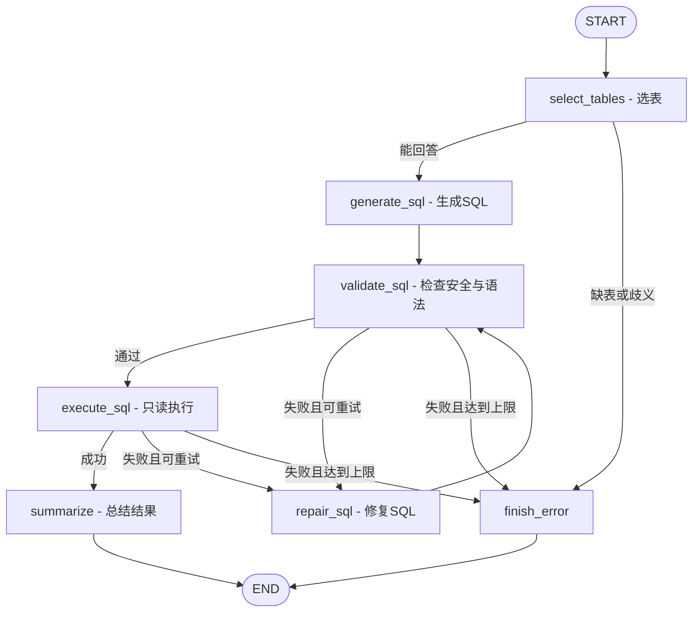

# SQL Agent LangGraph 教学复刻（基于上传的 week12/task2 作业）

**保留作业的原始数据库、四项 LLM 职责和确定性 SQL 安全门禁。**

作业原版 `SQLAgentWorkflow._run()` 使用 Python `for` 循环编排；
本项目把它换成 **LangGraph StateGraph** 的节点、条件边和显式回环。

## 1. 先看清楚结构



真实的 LLM 节点：`select_tables`、`generate_sql`、`repair_sql`、`summarize`。
真实的确定性代码节点：`validate_sql`、`execute_sql`、`finish_error`。

注意：这是**固定的多 LLM 工作流**，不是让模型自由规划下一步的自主 Agent。
LangGraph 解决的是状态流转与条件路由问题。

## 2. 文件说明

| 文件 | 作用 |
| --- | --- |
| `step0_minimal_graph.py` | 最小示例：State、Node、Edge、compile、invoke |
| `schemas.py` | Pydantic：规定模型回复结构 |
| `brains.py` | MockBrain（无需联网）和 LLMBrain（需真实 API） |
| `db_tools.py` | 只读 SQLite、Schema、EXPLAIN 校验、超时与截断 |
| `sql_graph.py` | 核心 StateGraph、节点和带重试上限的条件边 |
| `main.py` | CLI：mock/llm/stream/mermaid |
| `test_project.py` | 离线测试：正常查询、修复回环、危险 SQL 拦截 |
| `chinook.db` | 作业原始数据库 |

## 3. 安装与运行

建议 Python 3.11 / 3.12。

```bash
cd langgraph_sql_agent_tutorial
python -m venv .venv
# macOS / Linux：
source .venv/bin/activate
# Windows PowerShell：
# .venv\Scripts\Activate.ps1
pip install -r requirements.txt
```

先从最简单的图开始：

```bash
python step0_minimal_graph.py
```

然后完全离线查看 SQL Agent 的正常路径：

```bash
python main.py --mode mock "哪位歌手拥有最多专辑？"
```

输出结果应包含 `Iron Maiden` 和 `21`。**这是真实 SQLite 查询结果，而不是模型猜测。**

看一遍校验失败之后的回环：

```bash
python main.py --mode mock --inject-typo --stream "数据库里一共有多少张专辑？"
```

你会看到如下顺序：

```text
select_tables
generate_sql: SELECT COUNT(*) AS album_count FROM albumz
validate_sql: 失败，...no such table: albumz
repair_sql: 第 1 次修复 -> SELECT COUNT(*) AS album_count FROM albums
validate_sql: 通过
execute_sql: 成功
summarize: 完成
```

运行测试：

```bash
python -m unittest -v test_project.py
```

打印 LangGraph 自己生成的 Mermaid 图：

```bash
python main.py --mode mock --mermaid
```

## 4. 接入真正的 LangChain 大模型

把 `.env.example` 复制成 `.env`，配置自己的 Key，再运行：

```bash
python main.py --mode llm --stream "哪位歌手拥有最多专辑？"
python main.py --mode llm "消费金额最高的 5 位客户是谁？"
```

`LLMBrain` 使用：

```python
chain = prompt | llm.with_structured_output(schema_type, method="function_calling")
output = chain.invoke({"payload": json.dumps(payload, ensure_ascii=False)})
```

这对应原作业的结构化输出 Agent。OpenAI-compatible 模型需支持 tool calling；
如果服务商不支持，请替换成支持该功能的模型。**真实调用会消耗 API 配额，教学测试不用 Key。**

## 5. State 是 LangGraph 的核心

`SQLState` 是共享工作记录本：

```python
class SQLState(TypedDict, total=False):
    question: str       # 用户原始问题
    tables: list[str]   # 选中的表
    schema: str         # 已选表的真实结构
    sql: str            # 当前候选 SQL
    error: str          # 最新校验/执行错误
    repair_count: int   # 已修复次数
    columns: list[str]  # 数据库返回列
    rows: list[list[str]]
    answer: str
    trace: list[str]
```

节点只返回它本次修改的字段，例如：

```python
def generate_sql(state):
    draft = brain.generate_sql(state["question"], state["schema"])
    return {"sql": draft.sql, "error": ""}
```

Graph 会把这个部分更新合并进 State。此项目按线性分支串行执行，
`trace` 每次返回合并后的列表，没有并行更新冲突。

## 6. Edge 是 LangGraph 与普通链式调用的核心区别

正常边：

```python
builder.add_edge("generate_sql", "validate_sql")
```

条件边：

```python
builder.add_conditional_edges(
    "validate_sql", route_validation,
    {"execute": "execute_sql", "repair": "repair_sql", "stop": "finish_error"}
)
```

回边：

```python
builder.add_edge("repair_sql", "validate_sql")
```

路由函数不用 LLM 来判断 SQL 安全，而是根据**确定性 Python 校验结果**
和 `repair_count < max_repairs` 选择下一步。

## 7. 与作业的 OpenAI Agents / LangChain 版对比

| 原作业做法 | LangGraph 做法 |
| --- | --- |
| `Agent(...)` / 结构化输出链 | `LLMBrain` + Pydantic |
| Python 显式调用各 Agent | 图上的 `add_node()` |
| `for repair_index in range(...)` | `add_conditional_edges(...)` + 回边 |
| `QueryState` 对象 | `SQLState` 共享状态 |
| 单函数调用入口 | 编译后的图 `invoke()/stream()` |
| 人工打印日志 | State 中的 `trace` + `stream_mode="values"` |

## 8. 安全边界

- 数据库连接使用 SQLite `mode=ro` 与 `PRAGMA query_only`。
- SQL 校验限制为 SELECT/只读 WITH，通过 SQLite `EXPLAIN` 检查语法与对象。
- 单次查询有 progress handler 时间限制，单次最多返回 200 行，每个单元格限制长度。
- 校验失败 + 执行失败共用最多 3 次 LLM 修复，失败不会无限循环。
- 查询输出中的 `shown_rows` 是显示的行数，不是总结果集数量。
- 这是**教学版本**，并非完整 SQL 安全沙箱。正式生产环境需要更严格的 AST 检查、
  数据库权限隔离、字段级授权、资源限制、审计及提示注入防护。
- 不提供多轮记忆或持久化 checkpointer。LangGraph 支持这些功能，但不属于本次作业要求。

## 9. 下一步的练习

1. 在 `MockBrain` 中添加一个 SQL 查询：哪种音乐流派拥有最多曲目。
2. 在 `route_validation()` 改动修复次数上限，观察执行的节点序列。
3. 给 SQL Agent 添加 `approval` 人工审核节点（练习 LangGraph `interrupt()`）。
4. 改造为异步节点并添加持久化 `checkpointer`，实现恢复执行。
