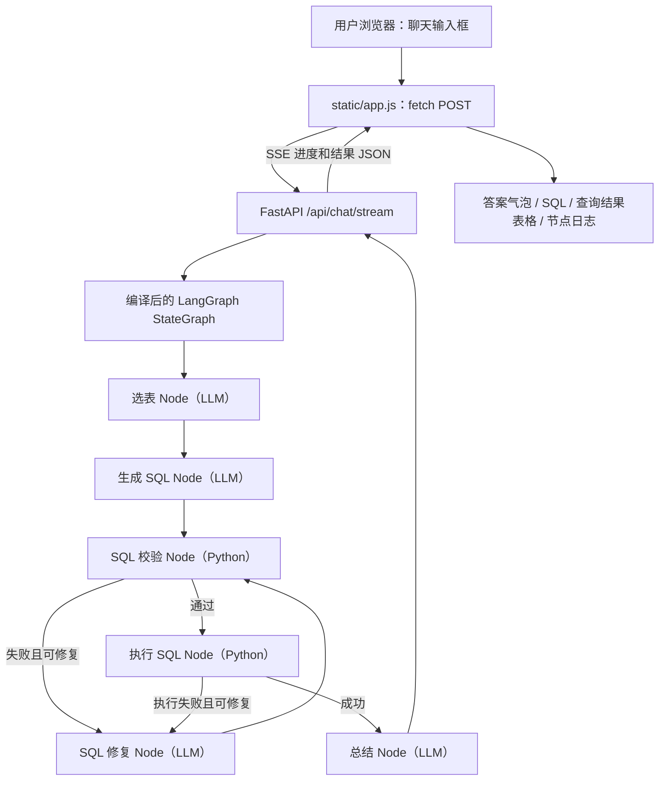

# QueryLab · LangGraph SQL Agent 网页版

原始作业：`week12/task2`；保留原来的 Chinook 数据库、LangGraph SQL 工作流和 4 个专职 LLM 模块。

## 1. 运行网页（最短路径）

需要 Python 3.10+，推荐 3.11/3.12。

```bash
cd langgraph_sql_agent_web

python -m venv .venv
# Windows PowerShell: .venv\Scripts\Activate.ps1
# macOS / Linux: source .venv/bin/activate

pip install -r requirements.txt
python run_web.py --mode mock
```

打开 **http://127.0.0.1:8000**。

Mock 模式无需 API Key，可以验证：输入对话 → LangGraph 节点 → 真实 SQL 查询 → 页面显示结果。Mock 只认识少量预设的中文问题；它不是在调用真实语言模型。

### 体验的问题

- 数据库里一共有多少张专辑？
- 哪位歌手拥有最多专辑？
- 消费金额最高的 5 位客户是谁？

这 3 个问题都由离线模拟器构造 SQL，**但查询结果实际来自 SQLite 数据库**。

## 2. 启用真实 LLM：查询任意自然语言问题

```bash
cp .env.example .env
# Windows 可以用复制文件命令，手动填入自己合法的 Key。

python run_web.py --mode llm
```

在 `.env` 中配置：

```dotenv
OPENAI_API_KEY=你自己的密钥
OPENAI_BASE_URL=https://dashscope.aliyuncs.com/compatible-mode/v1
LLM_MODEL=qwen-plus
```

这个示例接口为通义千问 OpenAI-compatible API；根据你自己的服务提供商更改。
必须选择支持 function/tool calling 的模型。
**浏览器不需要也不允许填写 API Key**，密钥只放在本机后端 `.env` 中。

若使用 OpenAI API，可按需设置：

```dotenv
OPENAI_BASE_URL=https://api.openai.com/v1
LLM_MODEL=gpt-4.1-mini
```

这会产生 API 费用。首次验证建议先使用 Mock 模式。

## 3. 系统结构



图中省略修复次数上限与错误出口，实际源码均已保留。

**注意**：每次提问都是独立调用一次 StateGraph，网页能显示当前页面内的消息历史，但后端不会自动记忆前面的问题。要实现“继续按上一条条件过滤”需要增加会话 ID、状态持久化和上下文整理；目前不提供多轮语义记忆。

## 4. 文件结构

```text
langgraph_sql_agent_web/
├── run_web.py             # 启动命令
├── web_app.py             # FastAPI 接口
├── sql_graph.py           # LangGraph 的节点、边、条件回环
├── brains.py              # MockBrain 与 LLMBrain
├── db_tools.py            # 只读 SQLite、schema、SQL 校验
├── schemas.py             # Pydantic 结构化输出
├── main.py                # 原来的命令行入口依然保留
├── step0_minimal_graph.py # 最小 StateGraph 学习示例
├── chinook.db             # 上传作业中的原始数据库
├── requirements.txt
├── .env.example
├── test_project.py        # LangGraph 离线工作流测试
├── test_web_app.py        # FastAPI 接口测试
└── static/
    ├── index.html        # 页面布局
    ├── styles.css        # 响应式样式
    └── app.js            # 聊天交互 / SSE / SQL 表格渲染
```

## 5. 网页 API 怎么工作？

### API 1：POST /api/chat（普通 JSON）

浏览器也可以不走 SSE，直接使用这个 API：

```bash
curl -X POST http://127.0.0.1:8000/api/chat \
  -H "Content-Type: application/json" \
  -d '{"message":"哪位歌手拥有最多专辑？"}'
```

服务端调用：

```python
graph = get_graph(selected_mode())
state = graph.invoke(
    {"question": question, "repair_count": 0, "trace": []},
    config={"recursion_limit": 40},
)
```

然后把 State 整理为标准 JSON：

```json
{
  "question": "哪位歌手拥有最多专辑？",
  "answer": "专辑最多的歌手是 Iron Maiden，共 21 张专辑。",
  "tables": ["artists", "albums"],
  "sql": "SELECT ...",
  "columns": ["artist", "album_count"],
  "rows": [["Iron Maiden", "21"]],
  "shown_rows": 1,
  "preview_rows": 1,
  "truncated": false,
  "repair_count": 0,
  "trace": ["select_tables: ...", "generate_sql: ...", "..."],
  "error": null,
  "success": true
}
```

上述 JSON 为结构示例；完整 SQL 和 trace 由真实运行返回。

### API 2：POST /api/chat/stream（网页默认用）

浏览器通过 `fetch()` POST，并把返回体当作 SSE 流解析。
每次一个节点完成后，后端用 `graph.stream(..., stream_mode="values")` 接收最新 State，并发送：

```text
event: progress
data: {"stage":"select_tables: ['artists', 'albums']"}

event: progress
data: {"stage":"generate_sql: SELECT ..."}

event: result
data: {"answer":"专辑最多的歌手是 ...", ...}
```

SSE 在这里是**节点进度推送**，不是大模型的逐 token 文字流。

### 关键关系

| 前端 | 后端 | LangGraph |
|---|---|---|
| textarea 输入问题 | Pydantic 验证 `ChatRequest` | 进入 State.question |
| fetch POST | FastAPI `/api/chat/stream` | `graph.stream(...)` |
| 进度列表 | SSE progress | 每个 Node 返回 State 更新 |
| 回答卡片 | SSE result | State.answer |
| SQL 折叠区 | JSON.sql | State.sql |
| 表格组件 | JSON.columns/rows | State.columns/rows |
| 修复次数 | JSON.repair_count | State.repair_count |

## 6. 测试

在安装依赖后执行：

```bash
python -m unittest -v test_project.py test_web_app.py
```

打开自动文档：

- http://127.0.0.1:8000/docs
- http://127.0.0.1:8000/api/health
- http://127.0.0.1:8000/api/config

## 7. 安全与部署边界

这是本地学习和演示程序，**不应原样暴露到公网**：

- 默认只监听 `127.0.0.1`。
- SQL 数据库只读模式；SQL 经过限定的安全检查、SQLite `EXPLAIN` 和执行限时。
- 允许修复最多 3 次，结果行数有限制；前端最多显示 40 行预览。
- 用户文本与查询结果使用 DOM `textContent` 插入，不把数据库文本作为 HTML 执行。
- API Key 不在前端，`.env` 在 `.gitignore` 中。
- 当前没有登录、鉴权、限流、用户隔离或数据级权限过滤，不适合公网或真实敏感数据。
- `MockBrain` 只是离线教学工具，不具备通用语言理解。
- 如果接入生产数据库，需增加 SQL AST 白名单、数据库最小权限、查询成本限制、审计、身份验证和敏感数据脱敏。

## 8. 推荐学习顺序

1. `static/app.js`：找到 `fetch("/api/chat/stream")`，理解网页怎么发送问题。
2. `web_app.py`：找到 `chat_stream()` 和 `graph.stream()`，理解 API 怎么调用图。
3. `sql_graph.py`：找到 `SQLState`、`build_graph()` 和 `add_conditional_edges()`。
4. `db_tools.py`：理解真实 SQL 校验与执行不交给大模型的原因。
5. `brains.py`：比较 `MockBrain` 和 `LLMBrain`。
6. 自己加一个新问题，例如“哪种音乐流派的曲目最多”。

下一阶段可以改造 LangGraph checkpointer 来实现真正多轮对话；也可以加上数据库表结构可视化、登录与日志监控。
