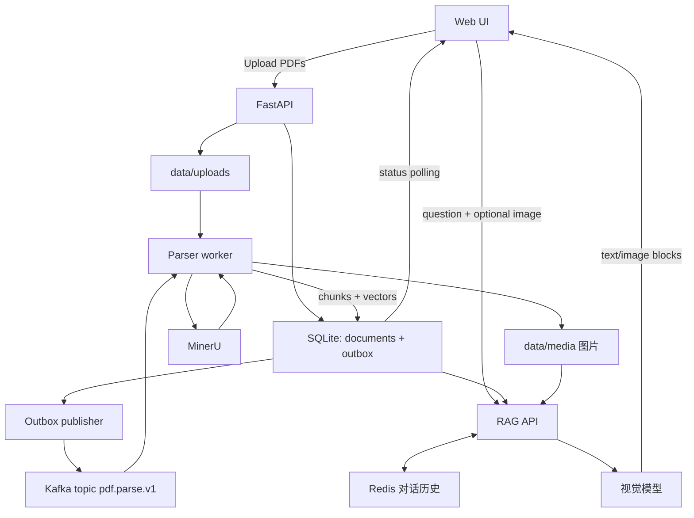

# 基于 Kafka 与 MinerU 的多模态 PDF 问答系统

> 第 14 周作业 1 + 作业 2 合并项目：Redis 对话历史、Kafka 消息传递、多 PDF 上传、解析状态、图文混排问答。

## 0. 作业要求对照

| 作业 | 要求 | 本项目实现 | 证据 |
| --- | --- | --- | --- |
| 作业1 | 注册 Compshare，提交 Company ID | Company ID 见本目录 `ID.txt` | `ID.txt` |
| 作业1 | Redis 存历史对话 | `redis_demo/redis_demo.py`；主系统 `/chat` 按 `session_id` 把多轮对话写入 Redis List（`chat:history:<id>`），可 `GET /sessions` 查看 | `截图/redis对话历史.png` |
| 作业1 | Kafka 传递消息 | `redis_demo/kafka_demo.py`：生产任务 → 消费处理 → 回写结果主题，并用 Redis SETNX 去重；主系统上传即发 Kafka 解析任务 | `截图/kafka消息.png` |
| 作业2 功能1 | 网页上传多个 PDF，经 Kafka 送到后端，后端用 MinerU 解析并存储 | 网页多选上传 → FastAPI 落盘 → outbox 发 `pdf.parse.v1` → worker 消费、调 MinerU、存原文/图片/文字块/向量 | `截图/上传与状态.png`、`截图/mineru解析输出.png` |
| 作业2 功能2 | 显示解析中、待解析、解析完成 | SQLite 保存 `queued/processing/ready/failed`，网页每 2 秒轮询，刷新后状态仍在；失败可重试 | `截图/上传与状态.png` |
| 作业2 功能3a | 图文混排回答 | 模型返回有序的 `text/image` 块，页面按顺序渲染图片并标页码 | `截图/图文问答.png` |
| 作业2 功能3b | 图问 + 文问一起送 LLM | 用户图片先转文字描述参与检索，原图连同问题、检索证据、命中文档原图一起送入视觉模型 | 同上 |

## 1. 项目简介

用户上传 PDF 后，服务端把文件保存到本机，并把解析任务发到 Kafka；独立的解析 worker 消费任务，调用 MinerU 提取文本、表格、图片和页码，生成图片描述、切块并写入向量索引。用户提问时（可附图片），系统检索相关片段和文档原图，再让视觉语言模型生成带来源页码的图文混排回答。多轮对话历史存放在 Redis，Kafka 负责把上传与耗时的解析解耦。

## 2. 组件与数据流

| 组件 | 职责 |
| --- | --- |
| `index.html` | 运行演示页：按操作顺序排好的截图说明（`/`） |
| `app.html` | 实际运行的问答页面：上传、状态、提问、图文混排回答（`/app`） |
| FastAPI（`app.py`） | 上传、状态查询、重试、PDF 访问、问答、会话列表 |
| Kafka / aiokafka | 解析任务主题 `pdf.parse.v1`，消息体 `{event_id, doc_id}` |
| MinerU | 解析 PDF，输出 `content_list.json`（文本、表格、图片路径、页码） |
| SQLite | 文档状态、待发送任务（outbox）、文本块与向量 |
| Redis | 对话历史（List + TTL）、演示中的消息去重 |
| 模型服务 | 文本向量（embedding）、图片描述与图文问答（视觉模型） |



### PDF 解析流程

1. 网页选择多个 PDF 上传；
2. API 校验数量、大小、扩展名、PDF 文件头，写入 `data/uploads/`；
3. 数据库同一事务里写入文档记录（`queued`）和 outbox 事件；
4. 后台发布器把 `{event_id, doc_id}` 发到 Kafka；
5. worker 消费后把状态改为 `processing`，调用 MinerU；
6. 读取 `content_list.json`，图片复制到 `data/media/` 并由视觉模型生成描述；
7. 文本切块（900 字、重叠 150 字）逐块生成向量；
8. 一个事务内写入检索块并把状态改为 `ready`；异常则记录 `failed` 和错误，可点重试。

### 多模态问答流程

1. 接收问题与可选图片（也支持只传图片）；
2. 有图片时先生成描述，和问题一起用于检索；
3. 检索文本向量取最相似的 5 个块；
4. 用户原图 + 问题 + 检索文字 + 命中文档原图一起送入视觉模型，要求返回 JSON 块；
5. 后端只接受本次检索命中的图片来源，前端按顺序渲染，附文件页码链接；
6. 问题与回答写入 Redis 对话历史，同一 `session_id` 的下一次提问会带上最近几轮（作为参考，证据仍来自检索）。

本项目采用“图片描述辅助文本检索 + 视觉模型看原图”的方案，没有做图文统一向量空间；回答中的图片来自上传的 PDF，不是模型生成。

## 3. 文件结构

```text
kafka_mineru_multimodal_rag/
├── app.py              # API + outbox 发布器 + 解析 worker + RAG + Redis 历史
├── index.html          # 运行演示页（截图说明）
├── app.html            # 问答页面
├── docker-compose.yml  # Kafka + Redis
├── requirements.txt
├── .env.example
├── architecture.mmd    # 系统结构图（Mermaid 源文件）
├── test_app.py         # 后端测试（Kafka / MinerU / 模型服务用替身）
├── test_ui.cjs         # 前端交互测试（模拟 DOM）
├── smoke_e2e.py        # 端到端冒烟：真实 Kafka + 解析 worker；MinerU/模型为离线替身
├── fake_mineru.py      # 冒烟用的解析器替身（输出同格式 Markdown）
├── redis_demo/
│   ├── redis_demo.py   # 作业1：Redis 存对话历史
│   └── kafka_demo.py   # 作业1：Kafka 传消息 + Redis 幂等
├── sample/             # 演示用 3 页 PDF 与提问图片
├── docs/               # 设计说明、验证记录、运行说明
└── 截图/               # 运行截图
```

## 4. 环境与启动

### 4.1 依赖

- Python 3.11+、Node（仅跑前端测试）、Docker（或本机 Kafka）
- MinerU 4.x：`pip install "mineru[pipeline]==4.2.1"`（4.x 用一个 `mineru` 命令统一管理文档库和本地服务）

```bash
python -m venv .venv
.venv/Scripts/python -m pip install -r requirements.txt      # Windows
# source .venv/bin/activate && pip install -r requirements.txt  # Linux
```

### 4.2 起 Kafka 和 Redis

```bash
docker compose up -d
```

主题在第一次启动后创建（若不存在）：

```bash
docker compose exec kafka /opt/kafka/bin/kafka-topics.sh \
  --bootstrap-server localhost:9092 --create --if-not-exists \
  --topic pdf.parse.v1 --partitions 1 --replication-factor 1
```

### 4.3 配模型

```bash
cp .env.example .env   # 填 MODEL_API_KEY  
```

| 配置项 | 作用 |
| --- | --- |
| `MODEL_API_KEY` | 模型服务密钥（只放本机 `.env`，不提交） |
| `MODEL_BASE_URL` | OpenAI 兼容地址，默认通义千问百炼 |
| `VLM_MODEL` / `EMBED_MODEL` | 视觉模型 / 向量模型 |
| `KAFKA_BOOTSTRAP_SERVERS` | 默认 `localhost:9092` |
| `REDIS_URL` | 默认 `redis://127.0.0.1:6379/0`；为空则对话历史退回内存 |
| `MINERU_BIN` | `mineru` 命令绝对路径（venv 中的 `Scripts/mineru.exe` 或 `bin/mineru`） |
| `MINERU_SUBCOMMAND` | `parse`（默认，MinerU 4.x）/ `cli`（2.x 的 `-p/-o/-b pipeline` 写法） |
| `MINERU_TIER` | `flash` 仅文本预览；`basic`/`standard` 需要本地 parse-server |
| `MINERU_CMD_TEMPLATE` | 可选，自定义完整命令（例如从 Windows 调 WSL 里的 MinerU），占位符见 `docs/截图说明.md` |
| `MINERU_CLI` / `MINERU_WSL_DISTRO` | 用模板跨环境调用时，图文档中定位符取图所使用的 CLI 与发行版 |
| `MINERU_FETCH_BASE` | 可选，解析服务把图片放在远端时，从该地址下载 `/media/<文件名>` |
| `KAFKA_GROUP_ID` | 消费者组名，默认 `pdf-parser-v1`；同一主题只能起一个默认组 worker |
| `CHAT_HISTORY_TURNS` / `CHAT_HISTORY_TTL` | 携带历史条数 / 历史过期秒数 |

### 4.4 启动 MinerU 本地服务

MinerU 4.x 的 `mineru parse` 需要先起本地服务（服务内部缓存解析结果）：

```bash
<venv>/Scripts/mineru.exe server start
<venv>/Scripts/mineru.exe server status
```

### 4.5 启动 API 和 worker

终端 A：

```bash
set -a && . ./.env && set +a
.venv/Scripts/python -m uvicorn app:app --host 127.0.0.1 --port 8000
```

终端 B（同一目录、同一 `.env`）：

```bash
set -a && . ./.env && set +a
.venv/Scripts/python app.py worker
```

打开 <http://127.0.0.1:8000/app>（问答页面），`/` 是按顺序排好的运行截图说明。
不要启动多个 uvicorn worker 进程或多个解析 worker。

### 4.6 作业1 的两个小演示

```bash
.venv/Scripts/python redis_demo/redis_demo.py                        # Redis 对话历史
.venv/Scripts/python redis_demo/kafka_demo.py producer 5             # 发 5 条消息
.venv/Scripts/python redis_demo/kafka_demo.py consumer 5             # 消费、去重、回写结果
```

## 5. 接口

| 方法和路径 | 说明 |
| --- | --- |
| `POST /documents` | 多文件字段 `files`，返回 202 与 `document_ids`（已受理） |
| `GET /documents` | 文件名、状态、错误 |
| `POST /documents/{id}/retry` | 仅失败文档可重试 |
| `GET /documents/{id}/pdf` | 原 PDF，可加 `#page=n` |
| `POST /chat` | 字段 `question`、可选 `image`、可选 `session_id`；返回 `blocks` + `sources` |
| `GET /sessions` | Redis 中已有对话会话（条数、剩余过期秒数） |
| `GET /queue` | Kafka 队列视角：已投递、待消费、文档总数 |
| `GET /app` | 问答页面；`GET /` 为截图说明页 |
| `GET /media/{file}` | 已保存的文档图片 |

## 6. 测试

```bash
.venv/Scripts/python test_app.py        # 11 个用例：切块、上传原子性、状态流转、重试、图文请求、Kafka 提交顺序
node test_ui.cjs                        # 前端交互
.venv/Scripts/python smoke_e2e.py       # 端到端：真实 Kafka + worker 进程；MinerU/模型用离线替身
```

测试通过只说明应用逻辑与合约没问题，真实模型效果、浏览器视觉需在运行机器上验收，见 `docs/验证记录.md`。

## 7. 消息与状态

状态：`queued`（待解析）→ `processing`（解析中）→ `ready`（解析完成）；异常进入 `failed`（解析失败），重试后生成新 `event_id` 回到 `queued`。

Kafka 主题 `pdf.parse.v1`，键为文档 ID，单分区单 worker。消费者关闭自动提交，处理完（或落失败状态）才提交 offset；文档与 outbox 同事务写入，减少“库里有任务但 Kafka 没收到”的情况；进程在标记 outbox 前崩溃可能重复发送，worker 用 `event_id` + 终态检查跳过重复。单任务超时 45 分钟。Kafka、SQLite、文件和模型服务之间不是“恰好一次”事务，崩溃重放可能重复调用 MinerU / 模型。

## 8. 局限

- 单用户、单 API、单 worker，无登录与隔离；所有 `ready` 文档都参与检索；
- SQLite 全量算相似度，适合小规模；没有重排序和相关性阈值；
- 图片描述可能漏细节，未做图文统一向量；
- 对话历史只是把最近几条带给模型参考，不做历史检索；
- 更换向量模型需要重建索引；
- 图片和问题会发送到配置的模型服务，只处理允许提交的资料。

## 9. 参考

- [Apache Kafka 消息语义](https://kafka.apache.org/design/)
- [aiokafka 消费者与手动提交](https://aiokafka.readthedocs.io/en/stable/consumer.html)
- [MinerU 官方文档](https://opendatalab.github.io/MinerU/)
- [Redis 数据类型：List](https://redis.io/docs/latest/develop/data-types/lists/)
