# 作业二：基于 Kafka 自己复刻一个多模态 RAG 问答

代码位置 `/workspace/hl_test/rag_kafka_multimodal`（作业一在同级目录）。

三条功能全部落地：

| 题目要求 | 实现 | 关键点 |
| --- | --- | --- |
| 功能 1：前端上传多个 PDF，经 Kafka 到后端，后端用 MinerU 解析并存储 | 上传接口只做「落盘 + 算哈希去重 + 投递 Kafka」，立即返回 `doc_id`；`parse_worker` 消费消息 → 调 MinerU 解析 → 切块 → 写 MySQL → 建 ES 索引 | 解析与 HTTP 请求彻底解耦，10 页和 300 页的上传响应时间一样 |
| 功能 2：前端能看到解析状态（待解析 / 解析中 / 解析完成） | MySQL 里一张 `rag_documents.status` 状态机，前端 2s 轮询；状态变更另外发到 `rag.doc.status` topic 做审计 | 状态先落库再发事件，Kafka 只是旁路通知 |
| 功能 3：多模态问答，输出图文混排，支持图文一起提问 | 检索返回正文 + 表格 + 图片块；图片以 `image_url` 塞进多模态 messages；答案里的 `[S1]` 角标与图片在正文内联渲染；提问时可上传图片一起送模型 | 图片靠 MinerU 生成的图注参与 BM25 召回，模型看到的是真图不是文字转述 |

---

## 一、效果

### 上传两个 PDF → 待解析（worker 未启动，任务堆在 Kafka 里）

左侧两篇都是「待解析」，底部管道面板 `分区堆积 P0:1 P1:1 P2:0` —— 两条任务分别在两个分区里排队。

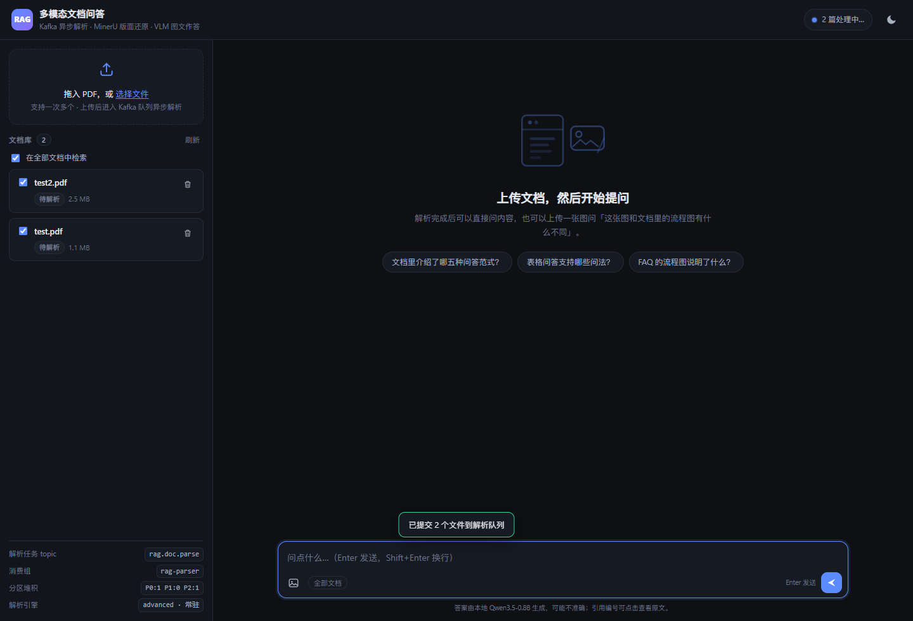

### 拉起 worker → 解析中

`test2.pdf` 变成「解析中」（带转圈和进度条），`test.pdf` 还在队列里，顶栏显示「2 篇处理中…」。

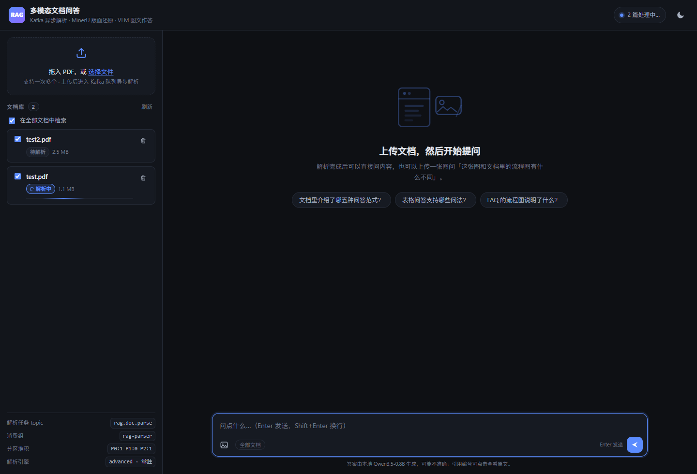

### 解析完成

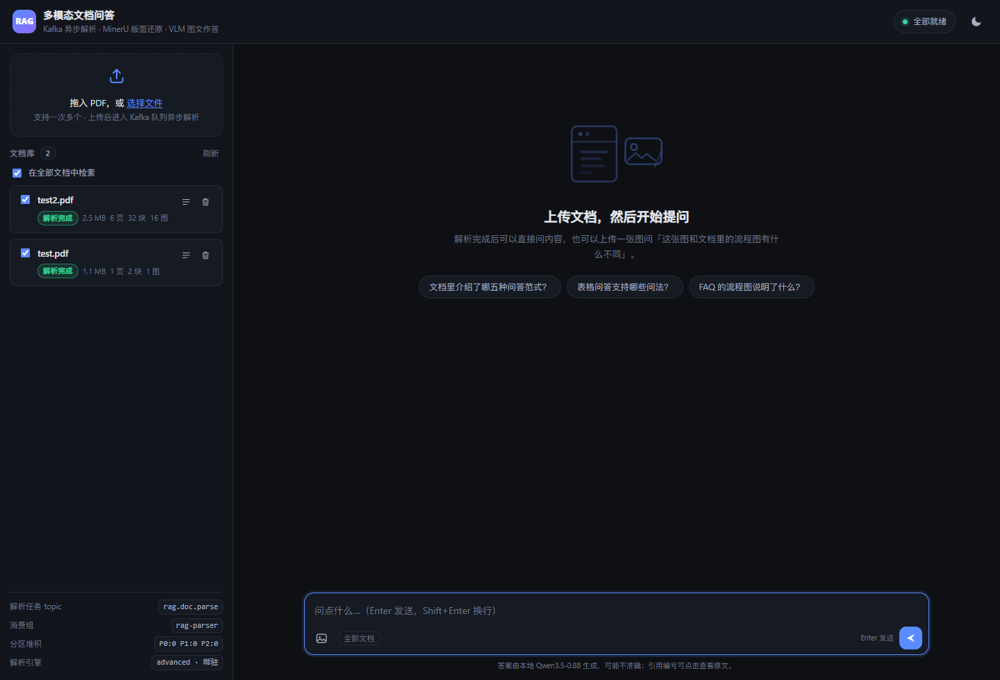

### 多模态问答：正文 + 内嵌图片

问「文档里介绍了哪五种问答范式」，答案把五种范式逐条列出，末尾把命中的表格 / 流程图直接嵌在回答里。

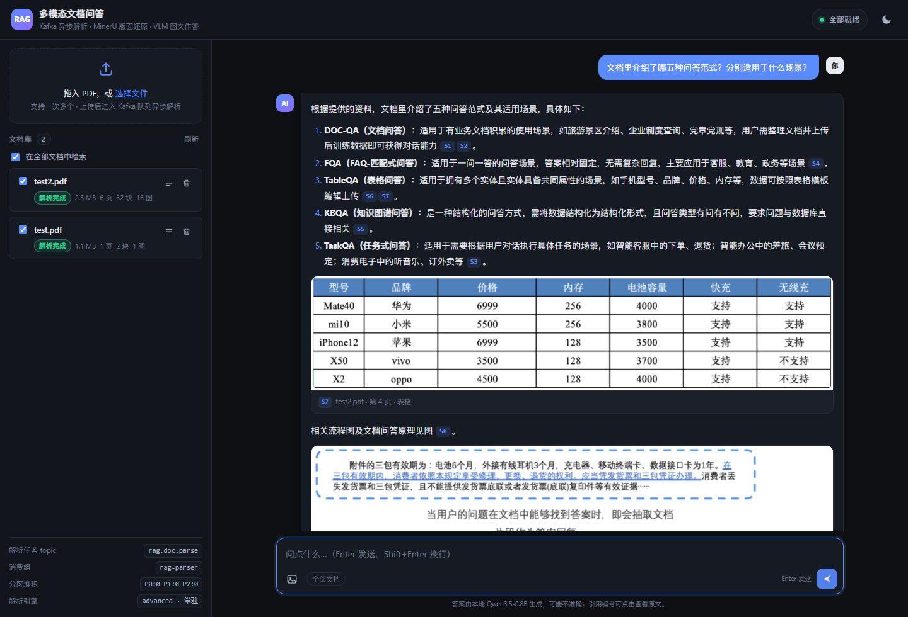

### 参考依据可展开、可回查

每条依据带文件名、页码、块类型、BM25 得分，图片类依据直接给缩略图；点正文里的 `S1` 角标会高亮对应依据。

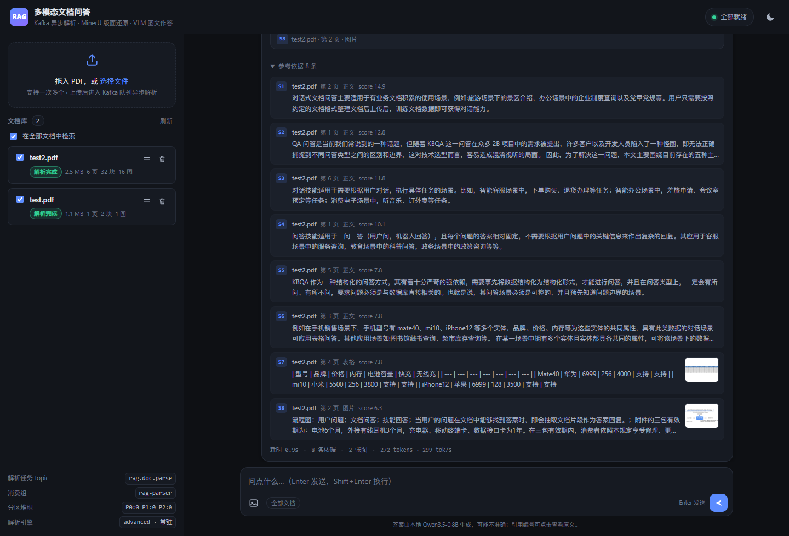

### 表格类问题

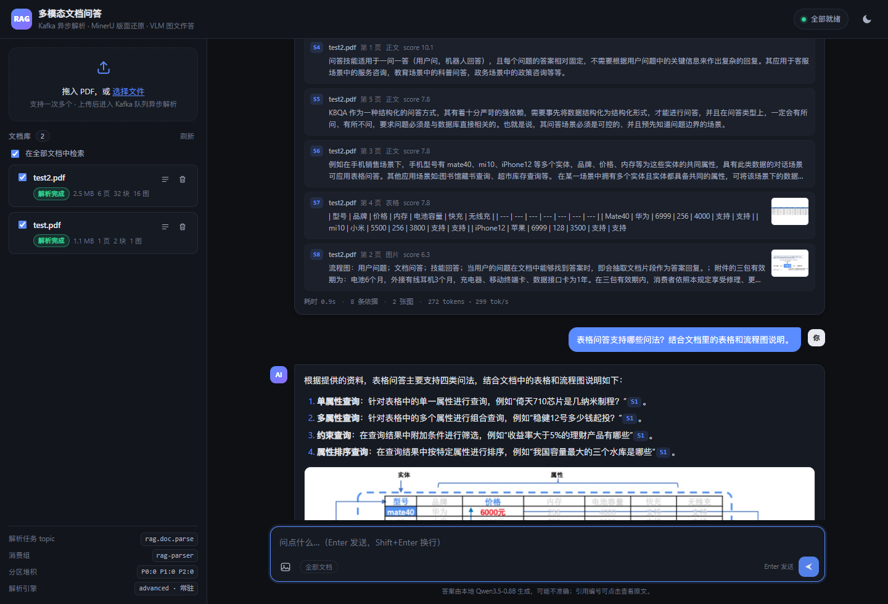

### 图问：自己上传一张图 + 文档一起问

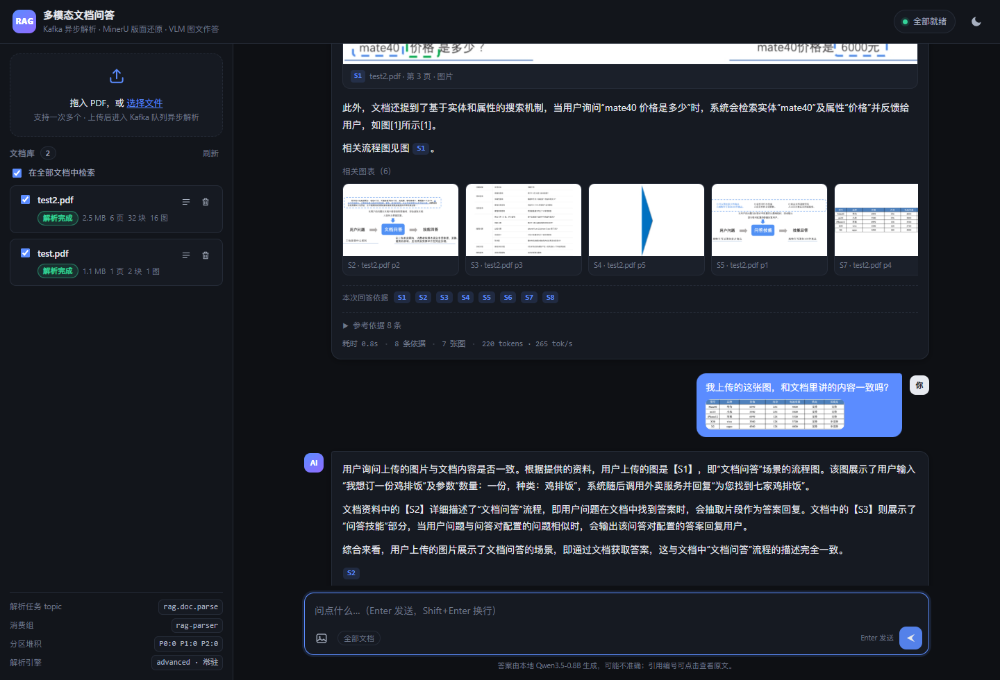

> 这张测试图是从文档里裁出来的手机参数表。模型的回答：「用户上传的图片是一张包含型号、品牌、价格、内存等信息的产品规格表」，并指出它与文档里「文档问答」场景不是一回事 —— 说明图片确实作为图像进了模型，不是被 OCR 成文字。

### Kafka 管道详情 / 浅色主题 / 移动端

<p>
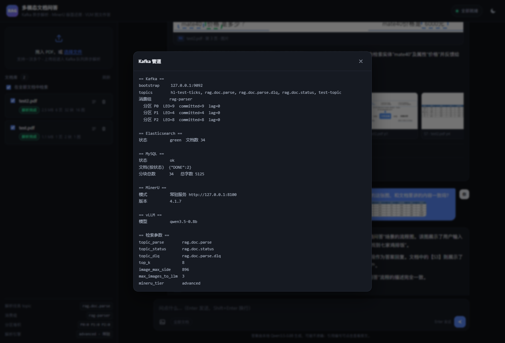
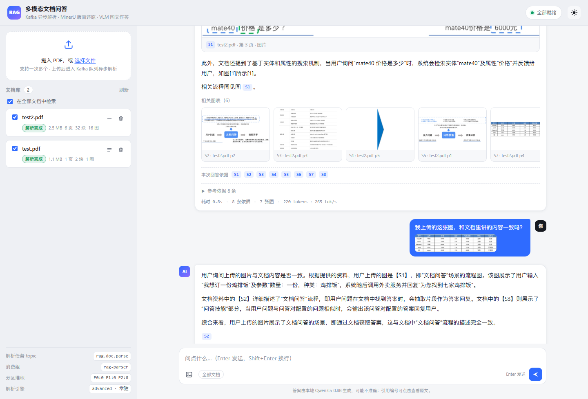
</p>
<p>
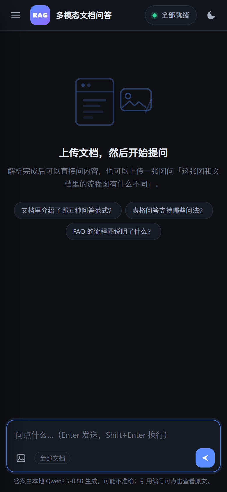
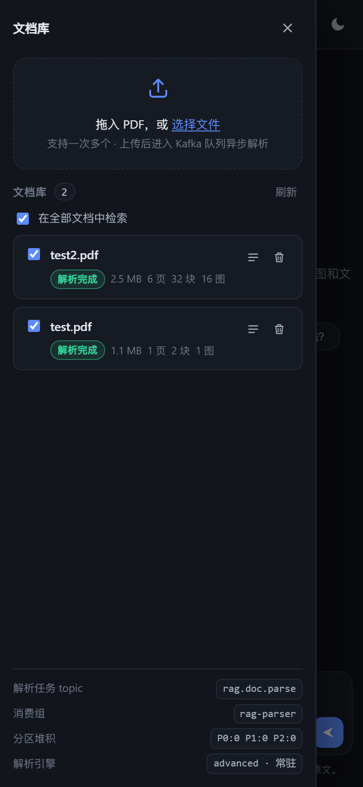
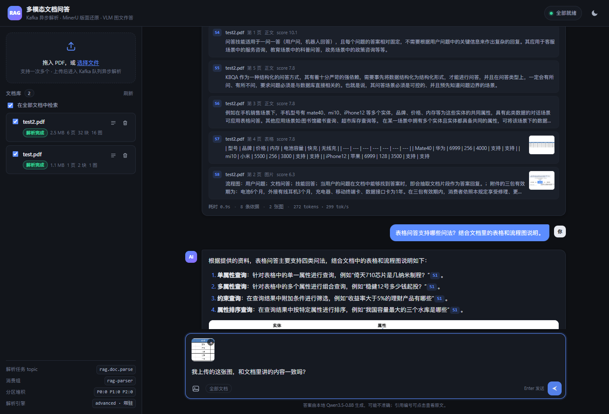
</p>

---

## 二、整体架构

```text
┌──────────────────────── 浏览器（原生 HTML/CSS/JS，无 CDN）────────────────────────┐
│  多文件拖拽上传   文档列表 + 状态徽章 + 进度条   对话区（图文混排 / 图问 / 引用角标）  │
└───────────────────────────────┬──────────────────────────────────────────────────┘
                                │ HTTP
┌───────────────────────────────▼──────────────────────────────────────────────────┐
│ api_server.py  (FastAPI :8080)                                                    │
│   POST /api/docs      多文件上传 → 落盘、sha256 去重 → produce → 立刻返回 doc_id     │
│   GET  /api/docs      文档列表（读 MySQL 状态）                                     │
│   POST /api/qa        SSE 流式问答：retrieved → delta… → final                      │
│   POST /api/ask_image 图问用的临时图片                                             │
│   GET  /api/health    Kafka/ES/MySQL/MinerU/vLLM 五项探活 + 分区堆积                │
└───────────────────────────────┬──────────────────────────────────────────────────┘
                                │ produce(key = doc_id)
                     ┌──────────▼──────────┐
                     │  rag.doc.parse      │  3 个分区
                     └──────────┬──────────┘
                                │ consume(group = rag-parser，手动提交位点)
┌───────────────────────────────▼──────────────────────────────────────────────────┐
│ parse_worker.py                                                                   │
│   PENDING → PARSING → DONE / FAILED（失败则重投一次，再失败进死信 topic）             │
│   MinerU api-server（常驻：8100）→ zip → structured_content.json → 切块             │
│   写 MySQL（rag_documents / rag_chunks）+ 建 ES 索引（rag_chunks_v1）              │
└───────────────────────────────┬──────────────────────────────────────────────────┘
                                │
┌───────────────────────────────▼──────────────────────────────────────────────────┐
│ 问答链路（在 api_server 进程内）                                                    │
│   1. 检索：ES BM25（ik_max_word）+ 多路 query + 意图加权 → topK 块                  │
│   2. 组装：正文/表格 → 文本；图片 → image_url（缩放后 base64）；再加用户上传的图      │
│   3. 生成：vLLM :8001 qwen3.5-0.8b，流式吐 token                                   │
│   4. 渲染：答案里的 [S1] → 角标；被引用的图片插到对应段落后                            │
└───────────────────────────────────────────────────────────────────────────────────┘
```

依赖服务：Kafka 4.4.0（KRaft）、MySQL 8.0、Elasticsearch 8.15.3（ik 分词）、
MinerU 4.1.7（常驻 api-server，advanced 档）、vLLM 0.25.1 + Qwen3.5-0.8B（多模态）。

---

## 三、目录结构

| 文件 | 作用 |
| --- | --- |
| `config.py` | 所有配置；支持 `.env`（内置极简解析，不引第三方库） |
| `bus.py` | Kafka：建 topic、生产者单例、手动提交的消费者、分区堆积查询 |
| `db.py` | MySQL：文档表 + 分块表、状态机更新、幂等查重 |
| `mineru_runner.py` | 调 `mineru-kit` 解析、解包、把 `structured_content.json` 归一化成块 |
| `chunker.py` | 切块：正文合并、图片/表格独立成块、维护标题路径 |
| `indexer.py` | Elasticsearch：mapping、bulk 写入、BM25 检索、图表兜底召回 |
| `rag.py` | 检索编排 + 多模态 messages 组装 + 引用抽取 |
| `llm.py` | vLLM 客户端，流式解析、`think` 段过滤 |
| `api_server.py` | FastAPI：上传、状态、SSE 问答、健康检查 |
| `parse_worker.py` | Kafka 消费者：解析任务的实际执行者 |
| `static/index.html` `style.css` `app.js` | 前端三件套（原生实现，深浅色 + 响应式） |
| `smoke_test.py` | 不开浏览器的全链路冒烟测试（20 项断言） |
| `scripts/start_services.sh` | 幂等拉起 MySQL/Redis/Kafka/ES/MinerU/vLLM |
| `scripts/start_app.sh` `stop_app.sh` | 起停 worker 与 Web（`start_app.sh 2` 可起两个 worker） |
| `运行结果.txt` | 启动日志、冒烟测试、接口调用的完整记录 |

---

## 四、快速开始

```bash
cd /workspace/hl_test/rag_kafka_multimodal

# 1) 拉起依赖（幂等，已在跑的端口会跳过；MinerU/vLLM 首次加载模型约 1~2 分钟）
bash scripts/start_services.sh

# 2) 起应用（1 个 worker + 1 个 web）
bash scripts/start_app.sh

# 3) 冒烟测试（不需要浏览器）
python3 smoke_test.py
```

浏览器打开 `http://<服务器IP>:8080`。手机连同一网络也能访问（服务监听 `0.0.0.0`）。

配置全部走环境变量或 `.env`（`cp .env.example .env`），不配也能用默认值跑起来。

---

## 五、三条链路

### 5.1 上传 → Kafka → 解析（功能 1）

上传接口刻意做得极薄：

```python
# api_server.py
sha = db.sha256_of(tmp)            # 内容哈希：同一份 PDF 传两次不会重复解析
if existing: 复用已有 doc_id
doc_id = db.new_doc_id(sha)
db.create_document(...)            # status = PENDING
bus.publish_parse(doc_id, name, path)   # produce 到 rag.doc.parse，key=doc_id
```

**为什么用 Kafka 而不是「上传完就地 `subprocess` 调 MinerU」**：

1. MinerU 是重活。一次解析要跑版面检测 + VLM 抽取，单页也要几秒；放在 HTTP 请求里，
   网关超时、浏览器断连、用户重复点上传都会出问题。
2. 解析能力有限（一张 4090）。用 Kafka 当缓冲区，突发 20 个 PDF 就排队，不会打爆显存。
3. 消费位点可控。worker 挂掉重启后，没提交位点的任务会被重新投递，任务不会丢。

去重用的是 `sha256` 上唯一索引，上传同一份文件第二次直接复用解析结果，前端会提示「内容已存在」。

### 5.2 状态机与状态展示（功能 2）

```text
            ┌─────────────┐  worker 认领   ┌────────────┐  MinerU 成功  ┌────────┐
  上传 ───▶ │  PENDING    │ ─────────────▶ │  PARSING   │ ────────────▶ │  DONE  │
            │  待解析      │                │  解析中     │               └────────┘
            └─────────────┘                └─────┬──────┘
                   ▲                             │ 失败且 attempt < 2
                   └─────────────────────────────┘ 重新投递（状态退回待解析）
                                                 │ 失败且 attempt >= 2
                                                 ▼
                                            ┌────────┐   同时写死信 topic
                                            │ FAILED │
                                            └────────┘
```

- **状态是事实**：MySQL `rag_documents.status` 是唯一真相，前端 `GET /api/docs` 轮询；
- **事件是旁路**：每次状态变更另外 `produce` 一条到 `rag.doc.status`，
  可以接通知、监控、重跑，丢了也不影响用户看到的状态；
- **前端**：`PENDING` 灰色「待解析」、`PARSING` 蓝色「解析中」+ 转圈 + 进度条、
  `DONE` 绿色「解析完成」并显示页数/分块数/图片数、`FAILED` 红色并展开错误信息；
  有任务在跑时，顶栏指示灯变蓝并显示「N 篇处理中…」。

### 5.3 多模态问答（功能 3）

**(a) 检索：图片怎么被搜到**

MinerU `advanced` 档会对 PDF 里的图做理解，产出图注（流程图还会转成 mermaid，
我们再抽成「流程图：节点 A；节点 B…」这句人话）。图注进 ES 的 `caption` 字段并加权 2.2，
所以「FAQ 的流程图说明了什么」这种问题能直接把那张图捞出来。

**(b) 组装：图文一起送模型**

```python
parts = [{"type": "text", "text": "资料 S1…S8 + 用户问题 …"}]
# 资料里的图片：缩放后以 data URL 塞进去，并标注是哪条证据
parts.append({"type": "text", "text": "【S8】对应的图片："})
parts.append({"type": "image_url", "image_url": {"url": "data:image/jpeg;base64,…"}})
# 用户自己上传的图
parts.append({"type": "text", "text": "【用户上传图 1】："})
parts.append({"type": "image_url", "image_url": {"url": "data:image/jpeg;base64,…"}})
```

单张图先缩到长边 896px（约 780 个视觉 token），一次最多送 3 张资料图 + 用户图，
避免 0.8B 的小模型被长上下文拖垮。

用户上传的图特意放在 `content` **最前面**：VLM 对开头的图注意力更强，而且「前面这 N 张是用户
上传的、后面带 S 编号的才是资料图」这个位置信息，能显著减少它把两者搞混的情况
（调整前模型经常说「资料中没有用户上传的图片」）。

**(c) 渲染：图文混排是怎么排的**

答案文本里保留 `[S1]` / `见图 S2` 这类标记，前端分两步：

1. `mdToHtml` 把 Markdown 转成 HTML，同时把 `[S1]`、`图 S8` 换成可点角标；
2. `decorateFigures` 遍历答案的每个段落，**哪个段落引用了图片证据，就把那张图插在该段之后**；
   正文一处图都没引到时，所有图片进入「相关图表」横向条带（标题明说「相关」，不冒充正文引用）。

这样只要模型按要求标注了「见图 S8」，读者就能在读到那句话的位置直接看到图；模型漏标时也不会凭空
把图塞进正文，而是老实放一条「相关图表」。模型连 `[S1]` 都没标时，还会补一条
「本次回答依据 S1 S2 …」的可点击依据条（点击高亮对应证据）。

**(d) 图问**

`POST /api/ask_image` 存图拿 `image_id`，提问时把 `image_ids` 一起带上；
后端把用户图和资料图一起塞进同一条 user message。也可以直接 Ctrl+V 粘贴图片。

---

## 六、Kafka 用法（为什么这么设计）

| 设计点 | 取值 | 原因 |
| --- | --- | --- |
| topic | `rag.doc.parse`（3 分区）、`rag.doc.status`（1）、`rag.doc.parse.dlq`（1） | 任务流和事件流分开；死信单独存，不再占用主流量 |
| message key | `doc_id` | 同一篇文档 hash 到固定分区 → 不会被两个 worker 同时处理；重投也落在同一分区 |
| 分区数 | 3 | 直接等于「最多几个 worker 真正并行」。多开第 4 个会空转（作业一验证过） |
| consumer group | `rag-parser` | `start_app.sh 2` 起两个实例，自动分摊分区 |
| offset 提交 | `enable_auto_commit=False`，每批处理完 `commit()` | at-least-once：进程被杀则位点不前进，重启后重投 |
| 重试 | 业务失败时**显式再投一条** `attempt+1` 的消息，然后正常提交 | 若用「不提交」来重试，会把整个分区卡死；显式重投让重试消息回到队列尾部正常排队 |
| 死信 | `attempt >= 2` 仍失败 → 写 `rag.doc.parse.dlq` 并置 `FAILED` | 人工可查、可重放，不污染主链路 |
| 幂等 | 消费时先查 DB：`DONE` 直接跳过；`replace_chunks` 先删后插 | 重投、重复上传都不会产生重复分块 |
| `max_poll_interval_ms` | 30 分钟 | 一篇 300 页的 PDF 解析可能很久，默认 5 分钟会触发 rebalance，导致「任务被抢走」 |
| 序列化 | `send()` 时手动 `json.dumps().encode()` | kafka-python 3.x 对旧式 lambda 序列化器已弃用，手动编码跨版本最稳 |

状态流可以现场验证：

```bash
# 另开一个窗口，观察每条消息落在哪个分区、位点是多少
/workspace/software/kafka_2.13-4.4.0/bin/kafka-console-consumer.sh \
  --topic rag.doc.parse --bootstrap-server localhost:9092 --property print.key=true

# 看堆积
python3 parse_worker.py lag
```

---

## 七、MinerU 解析与切块

**为什么常驻一个 `mineru-kit api-server`**：本地模式每跑一次 `mineru-kit parse` 都要重新
加载 MinerU2.5 的 VLM，实测 **46 秒起步**，而真正解析 6 页只要 7 秒。改成常驻服务后，
worker 通过 `--remote-url` 走 HTTP 提交，模型只加载一次，单篇解析稳定在 7~8 秒。

**输出物**（zip 包）：`markdown.md`、`structured_content.json`（按页组织的块）、
`middle_json.json`、`images/`。这里消费 `structured_content.json`，
因为它保留了块类型和坐标，而 markdown 已经把版面信息丢了。

**归一化的坑**：块类型实际有 `text / paragraph_title / doc_title / list / code / image / table`，
标题的层级在 `level` 字段里；表格的 `content` 有时是 `<table>` html、有时是 markdown 表格；
图片的 `content` 常常是 mermaid。`mineru_runner._norm_block` 把这些统一成
`{type: text|image|table, text, html, image, page, bbox, level}`。

**切块规则**（`chunker.py`）：

1. 连续正文合并到 ≤600 字，超了或跨页就断开（读者按页定位更准）；
2. 图片、表格各自独立成块 —— 它们是「多模态证据」，必须能被单独引用；
3. 维护标题栈，给每个块打上 `一级 › 二级` 的章节路径，检索时命中标题能显著提分，
   回答里也能说清「这段话出自 3.2 节」；
4. 没有图注的图片（纯装饰图或识别失败）用「章节名 + 中的插图」兜底，
   否则它的 `body` 是空的，永远检索不到。

实测 `test2.pdf`（6 页）：59 个原始块 → **32 个 chunk**（16 正文 / 11 图片 / 5 表格），
裁出 16 张图存到 `data/media/<doc_id>/`。

---

## 八、存储设计

### MySQL（事实来源）

```sql
rag_documents   id, filename, size_bytes, sha256(唯一), status, file_path, work_dir,
                pages, n_chunks, n_images, attempts, parse_seconds, engine,
                error, created_at, started_at, finished_at
rag_chunks      id, doc_id, idx, kind(text|image|table), section, text, html,
                image_path, page, bbox, n_chars
```

- 文档表负责状态机与统计；分块表是 ES 的源数据，重建索引时直接回灌（`POST /api/reindex`）；
- `sha256` 唯一索引做上传去重；`(doc_id, idx)` 索引保证按序取块。

### Elasticsearch（检索）

```json
{"mappings": {"properties": {
  "body":    {"type": "text", "analyzer": "ik_max_word"},
  "caption": {"type": "text", "analyzer": "ik_max_word"},
  "section": {"type": "text", "analyzer": "ik_max_word"},
  "kind": {"type": "keyword"}, "doc_id": {"type": "keyword"},
  "page": {"type": "integer"}, "has_image": {"type": "boolean"}
}}}
```

中文用 `ik_max_word`（`中华人民共和国` → `中华人民共和国/中华人民/中华/华人/人民共和国…`）。
检索是 `multi_match(body^1, caption^2.2, section^1.6)` + `match_phrase` 兜精确短语，
再用 `function_score` 做意图加权：问题里出现「图/表/流程/架构」时，`image` 块权重 ×2、
`table` 块 ×1.8；否则只做轻微倾斜。

**一次问答的召回**：原问题 + 去掉疑问词后的关键词串两路查询合并去重 → topK=8。
如果 8 条里一张图都没有，再补一条「最相关的图表块」（`indexer.best_visual`），
保证多模态链路不断。

---

## 九、接口

| 方法 | 路径 | 说明 |
| --- | --- | --- |
| `GET` | `/` | 网页 |
| `POST` | `/api/docs` | 多文件上传（multipart，字段名 `files`），逐个去重、逐个投递 |
| `GET` | `/api/docs` | 文档列表 + 全局统计 |
| `GET` | `/api/docs/{id}` | 单篇详情 |
| `GET` | `/api/docs/{id}/chunks` | 分块列表（前端「查看分块」用） |
| `DELETE` | `/api/docs/{id}` | 删文档：DB + ES + 图片 + 原文件 |
| `POST` | `/api/ask_image` | 图问用的临时图片 |
| `POST` | `/api/qa` | 流式问答（SSE） |
| `POST` | `/api/qa/sync` | 非流式，给脚本用 |
| `POST` | `/api/reindex` | 用 MySQL 分块重建 ES 索引 |
| `GET` | `/api/health` | 五项探活 + 分区堆积 + 检索参数 |

SSE 事件：

```text
data: {"type":"start","question":"…"}
data: {"type":"retrieved","evidence":[{…,"id":"S1","kind":"image","image_url":"/media/…"}],
       "images":[{"source":"S8","kind":"evidence"}],"elapsed":0.13}
data: {"type":"delta","text":"根据"}
…
data: {"type":"final","ok":true,"answer":"…","evidence":[…],"cited":["S1","S8"],
       "usage":{"completion_tokens":217},"elapsed":0.8}
```

`type=error` 表示服务端异常；`think` 事件是模型的思考段（有就透传，前端折叠显示）。

---

## 十、前端实现要点

1. **不依赖 CDN**，原生 HTML/CSS/JS，`fetch` + `ReadableStream` 手动解析 SSE
   （用 POST 传 JSON，`EventSource` 做不到）。
2. **图文混排**：见 5.3(c)。图片用 `object-fit: contain` 白底，点击可全屏放大。
3. **引用联动**：`[S1]` 角标 hover 高亮对应依据、点击滚动定位并展开依据面板。
4. **流式渲染节流**：`requestAnimationFrame` 合并重绘，631 个 token 分片不会触发 631 次 DOM 重建。
5. **输入安全**：所有内容先 `escapeHtml` 再做 Markdown 处理，模型输出不会被当 HTML 执行。
6. **移动端**：≤960px 侧栏变抽屉（带遮罩），≤620px 收紧间距、隐藏次要提示，
   在 390×844 下验证无横向滚动。
7. **深浅色**：默认跟随系统，可手动切换并记忆到 localStorage。

---

## 十一、运行结果

### 冒烟测试（20 项断言全过）

```bash
python3 smoke_test.py
```

覆盖：五项探活 → 多文件上传 → Kafka 异步解析轮询 → 分块类型统计 → 图片可访问
→ 非流式问答 → SSE 流式（分片数/retrieved/final）→ 证据含图片 → 图问 → 限定文档范围检索。

完整输出见 [`运行结果.txt`](运行结果.txt)，节选：

```text
[2] 多文件上传（multipart）
  ✔ 上传被接受  2/2 个
     test2.pdf   doc_id=d4ef0598c3087653 状态=PENDING  P1@3
     test.pdf    doc_id=db7de5e9c7987653 状态=PENDING  P0@7

[3] 轮询解析状态（Kafka → worker → MinerU）
     d4ef0598c3=PARSING  db7de5e9c7=PENDING
     d4ef0598c3=DONE     db7de5e9c7=PARSING
     d4ef0598c3=DONE     db7de5e9c7=DONE
  ✔ 全部解析完成
     test2.pdf: 6 页 / 32 块 / 16 图 / 7.38s

[5] 非流式问答
  ✔ 返回答案  425 字
  ✔ 命中证据  8 条
     …
     1. **DOC-QA（文档问答）**：适用于文档中已有业务内容 … [S1][S2]
     …
     5. **TaskQA（任务式问答）**：适用于需要执行具体任务的场景 … [S3]
     相关图结构见图 S8。

[6] 流式问答（SSE）
  ✔ 收到递增 delta  404 个分片
  ✔ 收到 retrieved 事件  8 条证据
  ✔ 收到 final 事件  654 字 / 1.29s
  ✔ 证据里含图片（图文混排的数据源）  7 张

[7] 图问：用户上传一张图 + 文档图一起送模型
  ✔ 用户图进入 prompt  ['U1', 'S1', 'S2', 'S3']
     答：用户上传的【S2】图片展示了“问答技能”部分 … 对比两者，
         【S2】图片中的问题是关于商品添加和权益的，而【S1】图片中的问题是
         关于外卖订单的 … 因此不能说是同一件事。

## 5. 消费位点与堆积（执行完应为 0）
  P0  LEO=8  committed=8  lag=0
  P1  LEO=4  committed=4  lag=0
  P2  LEO=7  committed=7  lag=0
```

### 实测性能（RTX 4090 24G）

| 环节 | 耗时 | 说明 |
| --- | --- | --- |
| 上传响应 | < 100ms | 只落盘 + produce，与 PDF 大小无关 |
| MinerU 解析（6 页） | 8~10s | 常驻服务；首次冷启动要额外 40~60s 加载模型 |
| 切块 + 入库 + 建索引 | < 300ms | 32 个 chunk 一次 bulk |
| 检索 | 10~30ms | ES 单节点，34 条 chunk 规模 |
| 首字节（TTFT） | 0.5~0.9s | 含检索 + 图片 base64 编码 |
| 生成速度 | 270~350 tok/s | Qwen3.5-0.8B，0.3 温度 |

