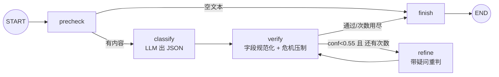
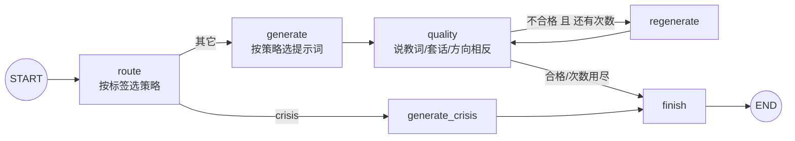
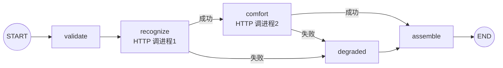
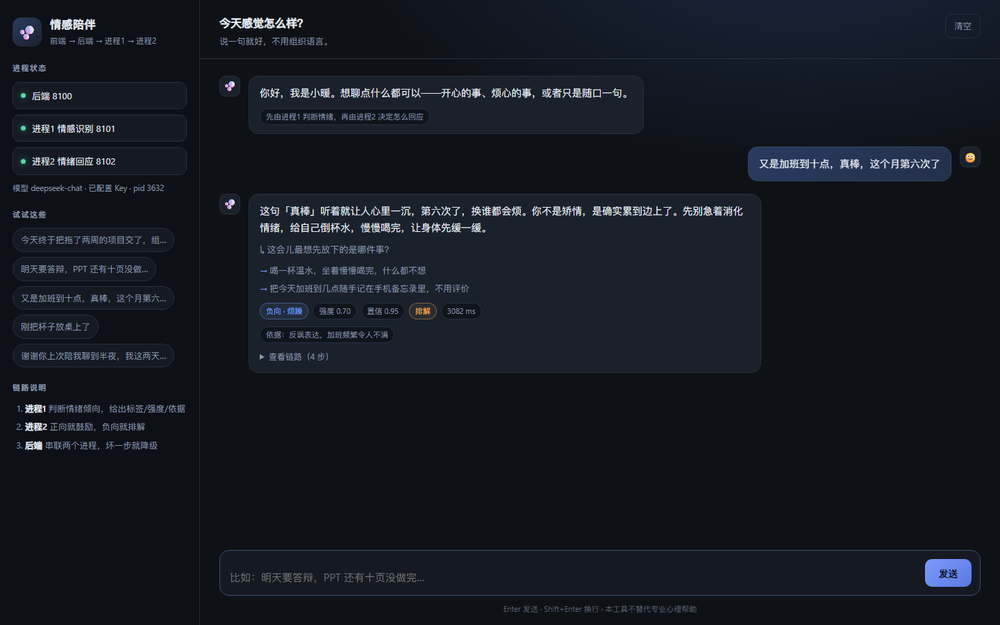

# 作业一：四进程情感陪伴链路（LangGraph 版 与 openai-agents 版）

同一套「进程1 情感识别 → 进程2 情绪回应 → 后端串联 → 前端输入」的逻辑，用两种框架各实现一遍。

| 题目要求 | 做法 |
| --- | --- |
| 进程1，接受请求进行情感识别 | 独立 FastAPI 服务（:8101），内部一张图 / 一个 Agent |
| 进程2，正向则鼓励、负面则排解 | 独立 FastAPI 服务（:8102），按标签分流到鼓励 / 排解 / 倾听 / 危机兜底 |
| 后端进程，接受前端输入，串联进程1 和进程2 | 独立进程（:8100），HTTP 调用两个子进程 + 任一步失败就降级 |
| 前端进程，用户输入 | 独立进程：CLI（`common/frontend_cli.py`）+ 由后端托管的网页 |

四个角色都是**真正的操作系统进程**（不是线程、不是同一个进程里的函数调用），
通信只走 HTTP + JSON，所以既能在本机一条命令起，也能一个进程一个容器（见 `../作业二`）。

## 架构

```text
         ┌──────────────────┐
         │   前端进程        │  CLI：common/frontend_cli.py（stdin/stdout）
         │  用户输入         │  网页：由后端托管静态页（浏览器）
         └────────┬─────────┘
                  │ POST /api/chat（或 /api/chat/stream，SSE）
         ┌────────▼─────────┐
         │   后端进程 :8100  │  校验输入 → 调进程1 → 调进程2 → 汇总 trace
         │   编排 + 降级      │  任一步失败：规则兜底，返回 degraded=true
         └───┬──────────┬───┘
   POST /analyze  │          │  POST /respond
         ┌────────▼───┐  ┌───▼────────────┐
         │ 进程1 :8101│  │ 进程2 :8102     │
         │ 情感识别    │  │ 情绪回应         │
         └────────────┘  └────────────────┘
```

进程间只有两个接口，数据契约在 `common/protocol.py`：

```jsonc
// 进程1 输出（SentimentResult）
{"label": "negative", "emotion": "焦虑", "confidence": 0.95, "intensity": 0.8,
 "reason": "答辩在即任务未完，担心完蛋", "keywords": ["要完蛋"]}

// 进程2 输出（ReplyResult）
{"strategy": "soothe", "reply": "听着就喘不上气了……", "tips": ["…"], "follow_up": "哪一页最卡？"}
```

## 目录

```text
作业一/
├── common/                  # 两个版本共用
│   ├── config.py            # 端口、模型、超时（环境变量覆盖）
│   ├── llm.py               # OpenAI 兼容协议封装 + JSON 容错解析
│   ├── protocol.py          # 进程间数据契约（pydantic）
│   ├── prompts.py           # 提示词
│   ├── rules.py             # 词典 / 质检规则 / 离线兜底
│   ├── rpc.py               # 同步 + 异步 HTTP 客户端
│   ├── service.py           # FastAPI 外壳：/health、日志、异常
│   ├── launch.py            # 一条命令起 4 个进程
│   ├── smoke.py             # 24 项断言的冒烟测试
│   ├── frontend_cli.py      # 前端进程（CLI）
│   └── static/              # 网页前端（后端托管）
├── langgraph_version/       # 进程1 / 进程2 / 后端 用 LangGraph 实现
│   ├── sentiment_service.py # 图：precheck → classify → verify ⇄ refine
│   ├── reply_service.py     # 图：route → generate → quality ⇄ regenerate
│   ├── backend.py           # 图：validate → recognize → comfort → assemble
│   ├── run_all.py
│   └── smoke_test.py
└── agents_version/          # 进程1 / 进程2 用 Agents SDK 实现
    ├── model.py             # 接入 DeepSeek 的三个必要动作
    ├── sentiment_service.py # Agent + 工具 + input_guardrail
    ├── reply_service.py     # Triage + handoff + output_guardrail
    ├── backend.py           # 后端：确定性编排（说明见下）
    ├── run_all.py
    └── smoke_test.py
```

## 跑起来

```bash
cd 作业一

# 1. 环境（Windows 用 .venv\Scripts\python.exe 替代下面的 python）
python -m venv ../.venv && ../.venv/bin/pip install -r requirements.txt

# 2. 配置 Key（两个版本共用 week15/.env）
cp ../.env.example ../.env      # 填入 LLM_API_KEY

# 3. 一条命令起 4 个进程
python -m langgraph_version.run_all --demo    # LangGraph 版：跑内置 6 条用例
python -m agents_version.run_all --demo       # Agents 版
python -m langgraph_version.run_all           # 起服务 + 交互式 CLI（:q 退出）
python -m langgraph_version.run_all --serve   # 只起服务，浏览器打开 http://127.0.0.1:8100

# 4. 冒烟测试（自己起服务、跑完自己关，24 项断言）
python -m langgraph_version.smoke_test
python -m agents_version.smoke_test
```

> 没有 Key 也能跑：链路会走规则兜底（`source=rule`），端口、SSE、降级逻辑照样能验证。

## LangGraph 版：三张图

**进程1（情感识别）**——`verify → refine` 是「判不准就换个问法再判」的回环：



**进程2（情绪回应）**——`generate → quality → regenerate` 是「写完先自己查一遍」的回环：



**后端（串联 + 降级）**：



三个图都能在线看：`GET /graph`（进程1、进程2）、`GET /api/graph`（后端，含两个子图）。

图之外还有两个刻意的设计：

- **策略选择是确定性的**：`pick_strategy()` 只用标签和危机词判断，不交给模型「自由发挥」，
  这样「正向必鼓励、负向必排解」是代码保证的，不是提示词祈祷来的。
- **质检用规则而不是模型**：`check_reply_rules()` 是纯 Python 的判断（说教词、套话、方向相反、
  越界诊断），所以「生成 → 质检 → 重写」这个回环真的会收敛，而不是模型自己给自己放水。

## openai-agents 版：Agent 组成

**进程1** 是一个 Agent + 一个工具 + 一个输入护栏：

```python
SENTIMENT_AGENT = Agent(
    name="SentimentAnalyst",
    instructions=prompts.SENTIMENT_SYSTEM + "必须调用 submit_sentiment 提交结论…",
    tools=[submit_sentiment],                 # 结构化出口
    tool_use_behavior="stop_on_first_tool",   # 工具返回即结束，不再多聊一轮
    input_guardrails=[non_empty_guardrail],   # 空输入 tripwire
    model=MODEL, model_settings=COLD,
)
run = await Runner.run(SENTIMENT_AGENT, prompt, run_config=RUN_CONFIG, max_turns=4)
result = SentimentResult.from_raw(json.loads(run.final_output))
```

**进程2** 是 Triage（分诊）+ handoff 到三个专家，外加一个输出护栏：

```text
Runner.run(Triage) ──handoff──> Encourager / Soother / Listener ──submit_reply──> JSON
                                   └── output_guardrail: 说教、套话、越界诊断 → tripwire → 重写
```

两条兜底是必须的，否则「让模型自己分流」就是不可靠：

1. **标签优先**：策略先由进程1 的标签算出来；crisis 直接跳过 Triage 交给 CrisisSupporter；
2. **分流纠正**：如果 handoff 落到的 Agent 和标签不符（比如阳性却落到 Soother），
   直接用正确的专家重跑，并把这次纠正写进 `notes`——正确性不挂在模型的自觉上。

**后端** 这一层**故意不再套一个 Agent**：`先识别、再回应` 是确定性顺序，
让模型来调度只会多两次往返（+2~4s）和一份不确定性；
Agents SDK 的价值在进程1/进程2 内部（工具、护栏、handoff），
后端的职责是编排和兜底，所以用显式 async 流水线，每步失败都能精确降级。

### 接国产模型踩的三个坑（`agents_version/model.py` 里有注释）

1. `set_default_openai_client` + `OpenAIChatCompletionsModel`：SDK 默认走 Responses API，
   DeepSeek 只有 Chat Completions；
2. `set_tracing_disabled(True)`：不然每个 run 都会往 OpenAI 上报 trace，没 Key 就一路 401；
3. `output_type` 不能用：SDK 会发 `response_format={"type":"json_schema"}`，
   DeepSeek 直接 400（`This response_format type is unavailable now`），
   所以改成「提交工具 + `stop_on_first_tool`」，工具返回的 JSON 就是结构化结果。

## 两版对比

| 维度 | LangGraph 版 | openai-agents 版 |
| --- | --- | --- |
| 编排单元 | 节点 + 条件边（显式图） | Agent + 工具 / handoff（隐式循环） |
| 结构化输出 | `chat_json` + `from_raw` 规范化 | 工具 schema + `stop_on_first_tool` |
| 「重试」怎么写 | 条件边回到上一个节点 | 外层 `for` 循环 + 捕获 tripwire |
| 分流 | 条件边，代码决定 | Triage Agent handoff，模型决定 + 代码纠正 |
| 护栏 | 无框架概念，靠规则函数 | `input_guardrail` / `output_guardrail`（tripwire） |
| 可观测性 | `GRAPH.get_graph().draw_mermaid()`、`stream_mode="updates"` | `RunResult.new_items`、`last_agent`、trace |
| 适合场景 | 流程固定但分支多、要可视化 | 需要委派、需要护栏、要接多家模型 |

## 前端

- **CLI 前端进程**：`common/frontend_cli.py`，SSE 逐条打印链路进度（`├─ 进程1 …`），
  支持 `--demo` / `--no-stream` / 直接传一句话；
- **网页前端**：由后端托管在 `:8100`，左侧实时探活三个进程，右侧对话；
  每条回复带标签、强度、策略、耗时，可展开看 4 步链路。



