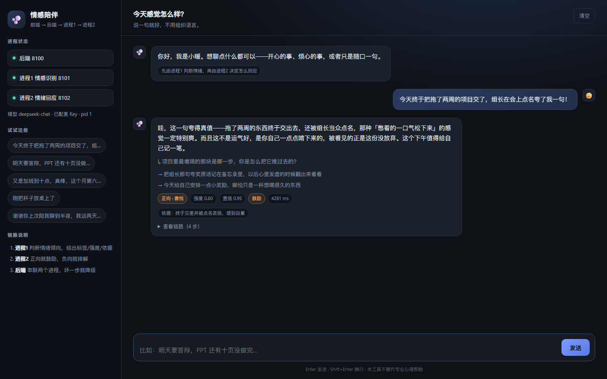

# 作业二：把作业1（openai-agents 版）打成 Docker 镜像

目标：作业1 的四个进程，在容器里也保持是四个进程——**一个镜像，四个角色，四个容器**。

| 项目 | 值 |
| --- | --- |
| 基础镜像 | `python:3.12-slim` |
| 镜像 | `week15-sentiment-chain:1.0` |
| 大小 | 302 MB（压缩后 66.7 MB） |
| 运行环境 | WSL2 Ubuntu 22.04 + Docker 29.1.3（`apt install docker.io`，systemd 托管） |
| 容器 | `w15-sentiment` `w15-reply` `w15-backend` + 前端容器（一次性） |

## 为什么是「一个镜像 + ROLE」

作业1 的四个进程跑的是同一份代码，区别只在入口模块。
如果做成四个镜像，`openai-agents`、`fastapi` 这些依赖会被下载和存储四遍；
用 `ROLE` 环境变量分发入口，构建一次、四条 `docker run` 共享同一份层：

```dockerfile
ENTRYPOINT ["/usr/local/bin/entrypoint.sh"]     # 按 ROLE 决定起哪个 python -m
```

```sh
ROLE=sentiment   -> python -m agents_version.sentiment_service   # :8101
ROLE=reply       -> python -m agents_version.reply_service       # :8102
ROLE=backend     -> python -m agents_version.backend             # :8100
ROLE=frontend    -> python -m common.frontend_cli                # stdin/stdout
```

容器之间的「进程边界」就是容器边界，靠 docker 网络里的服务名互相访问：

```text
frontend（一次性容器）
   │ http://backend:8100
backend
   ├── http://sentiment:8101     (--network-alias sentiment)
   └── http://reply:8102         (--network-alias reply)
```

## Dockerfile 里的几个决定

| 做法 | 原因 |
| --- | --- |
| 先 `COPY requirements.txt` 装依赖，再 `COPY` 源码 | 改代码只重建最后几层，重建从 1 分钟降到 2 秒 |
| `COPY app/common`、`COPY app/agents_version` | 构建上下文走 ASCII 路径（`scripts/sync_app.sh` 从 `../作业一` 同步），不依赖中文路径 |
| `PYTHONUNBUFFERED=1` | 不加的话 `docker logs` 看不到服务日志，排障会瞎 |
| 非 root 用户 `app` | 最小权限，容器被打穿也不是 root |
| `HEALTHCHECK` 打 `/health` | `docker ps` 直接显示 `(healthy)`，编排时不用另写探活脚本 |
| Key 走 `-e LLM_API_KEY`，不进镜像 | 镜像会被推送/共享，Key 一旦进层就洗不掉（历史层里也有） |

## 构建与运行

```bash
cd 作业二

# 1. 构建（会自动从 ../作业一 同步代码到 app/）
sh scripts/build.sh

# 2. 起三个服务容器（映射 8100/8101/8102，Key 从 ../.env 读）
sh scripts/run.sh up

# 3. 在容器里跑「前端进程」：内置用例 / 交互式
sh scripts/run.sh demo
sh scripts/run.sh cli

# 4. 浏览器打开 http://127.0.0.1:8100 （网页前端也在这个镜像里）

# 5. 收工
sh scripts/run.sh down
```

手动等价命令：

```bash
docker build -t week15-sentiment-chain:1.0 .
docker network create week15-net
docker run -d --name w15-sentiment --network week15-net --network-alias sentiment \
  -e ROLE=sentiment -e PORT=8101 -e LLM_API_KEY=$LLM_API_KEY week15-sentiment-chain:1.0
docker run -d --name w15-backend --network week15-net --network-alias backend -p 8100:8100 \
  -e ROLE=backend -e PORT=8100 -e SENTIMENT_URL=http://sentiment:8101 \
  -e REPLY_URL=http://reply:8102 -e LLM_API_KEY=$LLM_API_KEY week15-sentiment-chain:1.0
```

## 实测



- 三个容器都 `(healthy)`，镜像 302 MB；
- 容器内 `--demo` 6 条用例全部按预期分流（正向→encourage，负向/反讽→soothe，中性→listen，危机→crisis）；
- 端到端 2.0~5.9s，与直接跑在本机同一量级（瓶颈是模型调用，不是容器）；
  容器内 `/health` 全部 healthy，`/api/meta` 回填的端口与映射一致。

